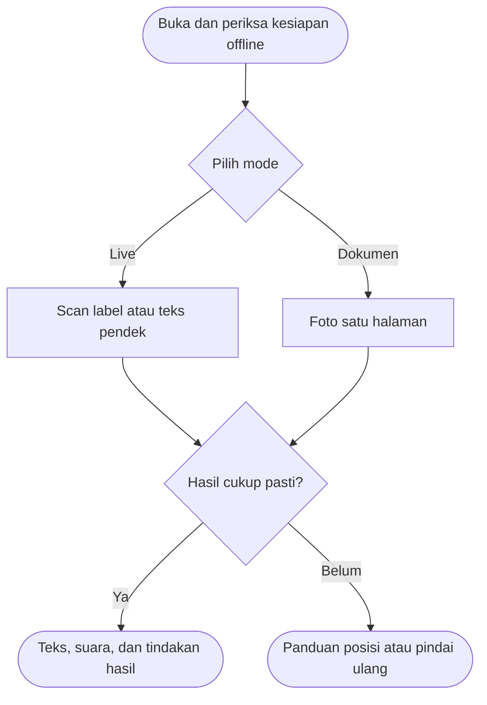
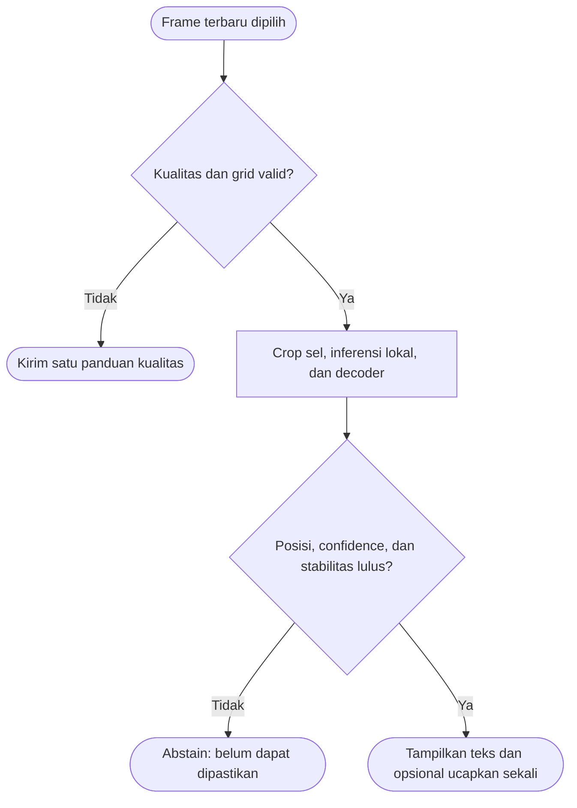
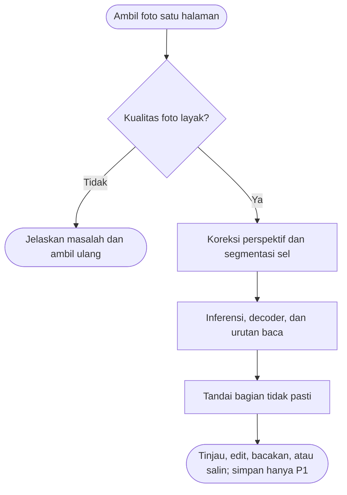
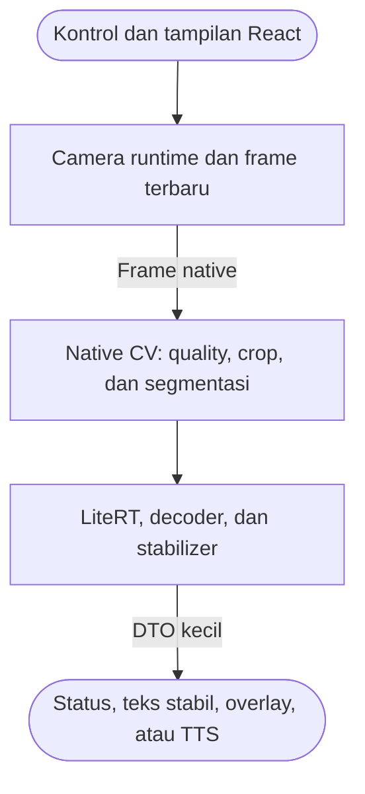
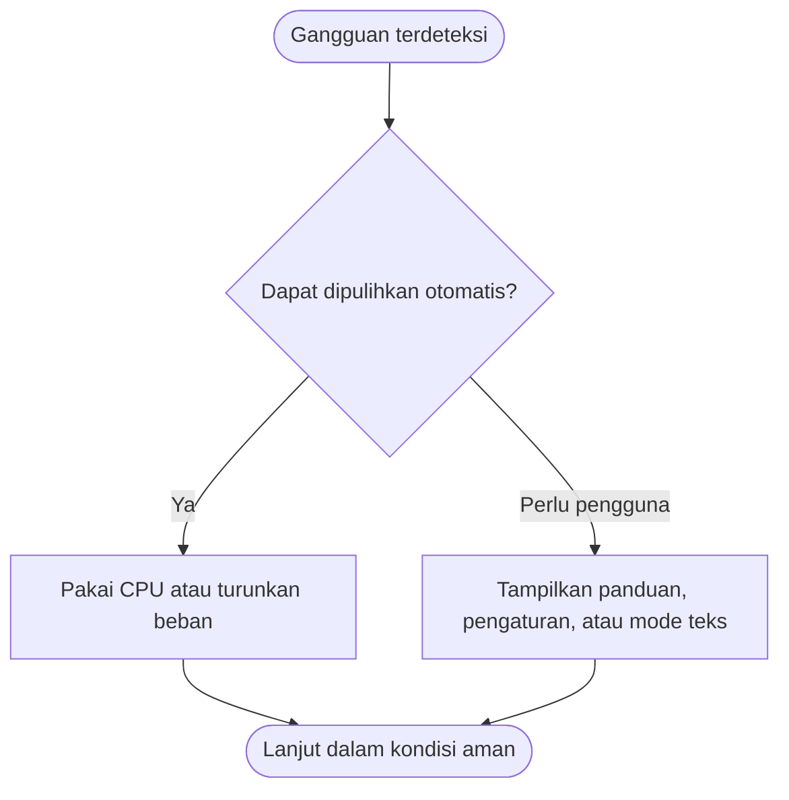
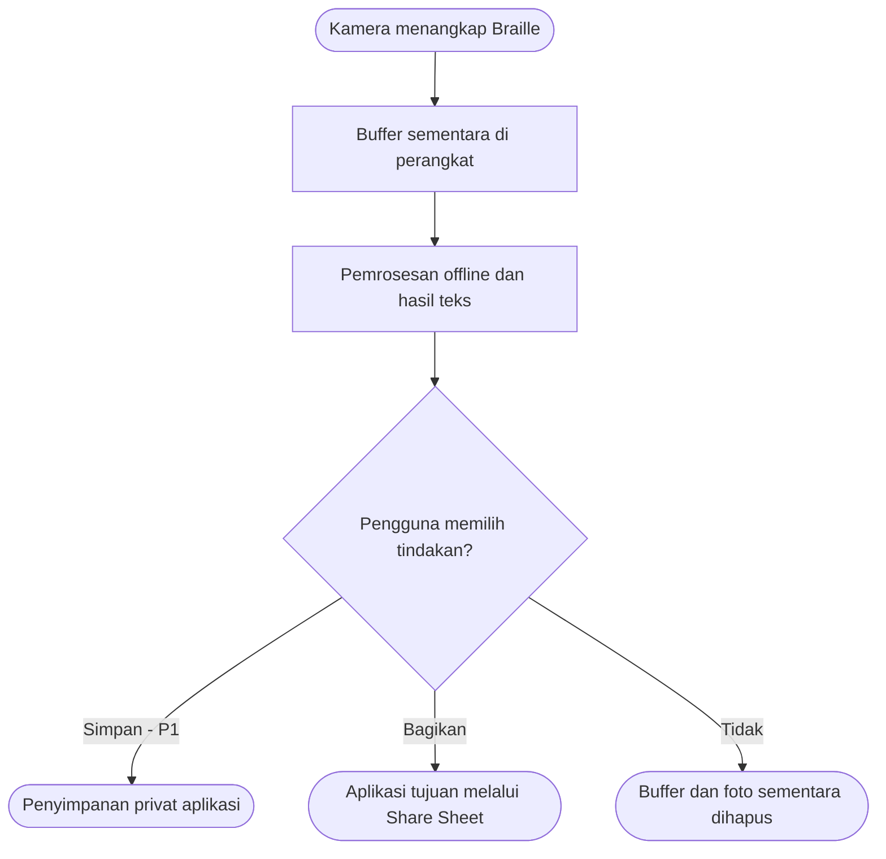
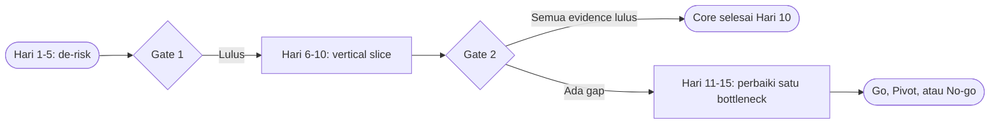

# PRD - BrailleMe

**Product Requirements Document**  
**Nama resmi produk:** BrailleMe  
**Versi:** 1.5 - Technical Alpha Plan  
**Tanggal:** 8 Agustus 2026

> [!abstract] Ringkasan
> BrailleMe adalah aplikasi Android yang mengenali Braille fisik melalui kamera, lalu mengubahnya menjadi teks digital dan suara secara offline. Target aktif dokumen ini adalah technical alpha untuk Live satu baris dalam 10 hari kerja, dengan 5 hari tambahan hanya untuk validasi, hardening, atau pemulihan kegagalan.

## Kontrol Dokumen

| Atribut | Nilai |
|---|---|
| Status | Rencana aktif technical alpha; belum production-ready |
| Pemilik produk | Solo developer, interim |
| Pemilik teknis | Solo developer, interim |
| Pemilik model ML | TBD |
| Reviewer aksesibilitas | TBD |
| Sumber kebenaran | `PRD - BrailleMe.md` |
| Audiens | Product, design, mobile, ML, QA, accessibility, stakeholder |
| Ketentuan perubahan | Perubahan Technical Alpha Contract, lingkup P0, atau evidence gate wajib dicatat pada Change Log |

## Decision Snapshot

| Keputusan | Nilai yang Dikunci untuk Alpha |
|---|---|
| Nama resmi | **BrailleMe**; nama terdahulu dipertahankan hanya pada aliases frontmatter |
| Outcome aktif | Vertical slice **Live satu baris** yang bekerja offline pada kondisi terkontrol |
| Timeline | Hari 1-10 untuk hasil inti; Hari 11-15 hanya buffer, hardening, dan evidence |
| Kapasitas | Satu solo developer; work in progress maksimal satu bottleneck utama |
| Input alpha | Braille 6 titik, A-Z dan spasi, uncontracted, sisi timbul depan, satu baris 3-12 sel |
| Media/perangkat | Permukaan datar, pencahayaan terkontrol, satu Android autofocus sebagai reference device |
| Stack awal | Expo SDK 57.0.11 + React Native 0.86.2 + TypeScript + Expo Router untuk UI/orkestrasi; VisionCamera/worklets/resizer 5.2.2; fast-tflite 3.0.1; Worklets 0.11.3; Nitro 0.36.5 |
| Pendekatan | Hybrid CV terlebih dahulu; TFLite cell classifier hanya bila grid sudah benar dan klasifikasi sel menjadi bottleneck |
| Evidence gate | Stable-token precision >= 90%; coverage >= 60%; p95 <= 2 detik; preview >= 24 FPS; soak 10 menit |
| Penyimpanan alpha | Tidak ada penyimpanan hasil atau gambar; teks hidup selama sesi |
| TTS alpha | **Tekan untuk membaca** sebagai default; auto-speak hanya opsi pengujian dengan voice lokal |
| Diagnostik pengembangan | Debug Menu mati secara default, hanya dapat diaktifkan dari Pengaturan, dan menampung readiness, status adapter, profil internal, serta scope build agar istilah implementasi tidak muncul pada layar utama pengguna |
| Keputusan tertunda | Pengesahan Braille Indonesia, dataset/model produksi, validator domain, multi-device, Dokumen, dan rilis Play Store |

> [!warning] Kontrak alpha, bukan MVP produksi
> Kelulusan alpha hanya membuktikan kelayakan engineering pada capture envelope yang sempit. Hasil tidak mengesahkan standar Braille Indonesia, kualitas lapangan, aksesibilitas pengguna nyata, atau kesiapan distribusi.

**Canvas eksekusi:** [[Roadmap - BrailleMe - Technical Alpha.canvas]]

## Daftar Isi

0. [Decision Snapshot](#decision-snapshot)
1. [Ringkasan Eksekutif](#1-ringkasan-eksekutif)
2. [Latar Belakang dan Masalah](#2-latar-belakang-dan-masalah)
3. [Visi, Misi, dan Prinsip Produk](#3-visi-misi-dan-prinsip-produk)
4. [Tujuan dan Bukan Tujuan](#4-tujuan-dan-bukan-tujuan)
5. [Pengguna Sasaran dan Jobs to Be Done](#5-pengguna-sasaran-dan-jobs-to-be-done)
6. [Asumsi dan Batas Dukungan](#6-asumsi-dan-batas-dukungan)
7. [Lingkup Rilis](#7-lingkup-rilis)
8. [Perjalanan dan Alur Pengguna](#8-perjalanan-dan-alur-pengguna)
9. [Kebutuhan Fungsional](#9-kebutuhan-fungsional)
10. [Spesifikasi UX dan Aksesibilitas](#10-spesifikasi-ux-dan-aksesibilitas)
11. [Sistem ML dan Data](#11-sistem-ml-dan-data)
12. [Arsitektur dan Keputusan Teknologi](#12-arsitektur-dan-keputusan-teknologi)
13. [Kebutuhan Non-Fungsional](#13-kebutuhan-non-fungsional)
14. [Privasi, Keamanan, dan Kepercayaan](#14-privasi-keamanan-dan-kepercayaan)
15. [Metrik Keberhasilan](#15-metrik-keberhasilan)
16. [Strategi Pengujian](#16-strategi-pengujian)
17. [Rencana Rilis dan Gate](#17-rencana-rilis-dan-gate)
18. [Risiko dan Mitigasi](#18-risiko-dan-mitigasi)
19. [Dependensi](#19-dependensi)
20. [Keputusan dan Status](#20-keputusan-dan-status)
21. [Matriks Ketertelusuran](#21-matriks-ketertelusuran)
22. [Persetujuan dan Definition of Done](#22-persetujuan-dan-definition-of-done)
23. [Lampiran](#lampiran)

---

## 1. Ringkasan Eksekutif

BrailleMe memungkinkan pengguna yang belum menguasai Braille untuk memahami teks Braille fisik tanpa mengirim gambar ke server. Pengguna mengarahkan kamera ke label, rambu, kemasan, atau dokumen Braille. Aplikasi mendeteksi sel Braille, mengurutkan hasil sesuai arah baca, mengubah simbol menjadi teks, menandai bagian yang tidak pasti, lalu membacakan hasil menggunakan mesin Text-to-Speech Android.

Produk memprioritaskan empat hal:

1. **Privasi:** data gambar dan hasil tetap di perangkat.
2. **Kecepatan:** umpan balik langsung pada mode Live.
3. **Akurasi yang jujur:** bagian tidak pasti ditandai dan tidak dibacakan sebagai fakta tanpa ambang keyakinan.
4. **Aksesibilitas:** alur utama dapat diselesaikan dengan TalkBack, ukuran teks besar, haptik, dan kontrol non-visual.

MVP menargetkan Braille enam titik, tidak disingkat, berbasis alfabet Latin, angka, tanda kapital, spasi, dan tanda baca dasar. Dukungan singkatan tingkat lanjut, Braille delapan titik, matematika, musik, dan kimia berada di luar MVP sampai standar, dataset, dan kebutuhan pengguna divalidasi.

> [!important] Definisi "offline"
> Seluruh akuisisi gambar, pra-pemrosesan, inferensi, dekode, dan penampilan hasil utama harus berfungsi dalam mode pesawat. TTS hanya boleh memilih voice lokal dengan `Voice.isNetworkConnectionRequired() == false`. Pemasangan paket voice dapat memerlukan internet di luar BrailleMe, tetapi kegagalan voice tidak boleh menggagalkan hasil teks atau memicu fallback jaringan diam-diam.

> [!note] Istilah produk
> Di antarmuka, istilah "terjemahkan" dapat digunakan karena lebih mudah dipahami. Secara teknis, proses utama adalah pengenalan dan transliterasi simbol Braille ke karakter digital, bukan penerjemahan antarbahasa.

### 1.1 Pernyataan Produk

**Untuk** pendidik, keluarga, staf layanan, dan pengguna umum yang perlu memahami Braille fisik, **BrailleMe adalah** alat pemindai Android offline **yang** mengubah Braille menjadi teks dan suara langsung di perangkat, **berbeda dari** alur berbasis server atau transkripsi manual, **karena** aplikasi menjaga privasi, tetap berfungsi tanpa internet, dan memberikan tingkat keyakinan serta mekanisme koreksi.

### 1.2 Hipotesis Nilai

Jika pengguna dapat memindai Braille fisik secara offline dengan panduan pengambilan gambar yang jelas, hasil yang dapat dikoreksi, dan suara yang terkendali, maka mereka akan menyelesaikan tugas pemahaman Braille lebih cepat dan lebih percaya diri dibanding menyalin pola titik secara manual atau menunggu bantuan ahli.

## 2. Latar Belakang dan Masalah

### 2.1 Masalah Utama

- Sebagian besar pengguna umum dan banyak pendamping atau pendidik belum dapat membaca Braille dengan lancar.
- Braille timbul sulit dipotret karena penampakan titik berubah menurut arah cahaya, bayangan, bahan, sudut, dan kondisi permukaan.
- Pemrosesan berbasis server tidak selalu tersedia, menambah latensi, dan dapat menimbulkan kekhawatiran privasi untuk dokumen pribadi.
- Hasil pengenalan yang salah tetapi dibacakan tanpa peringatan dapat menciptakan rasa yakin yang keliru.
- Pemindaian halaman penuh bukan sekadar klasifikasi satu gambar; sistem harus menemukan sel, menentukan baris, menjaga urutan, dan mendekode indikator konteks.

### 2.2 Peluang

- Kamera Android dan runtime ML di perangkat sudah memadai untuk model kecil yang dioptimalkan.
- Pipeline lokal dapat memberi respons cepat sekaligus menghilangkan kebutuhan unggah.
- Mode Live dan Dokumen dapat melayani dua pekerjaan berbeda tanpa memaksa satu kompromi UX.
- Umpan balik kualitas gambar sebelum inferensi dapat meningkatkan hasil sekaligus mengurangi beban komputasi.

### 2.3 Pernyataan yang Harus Divalidasi

| ID | Asumsi | Status Awal | Cara Validasi |
|---|---|---|---|
| A-01 | Pendidik dan pengguna umum membutuhkan pembacaan Braille sesekali | Belum terbukti | 8-12 wawancara kontekstual |
| A-02 | Akurasi karakter >= 90% pada kondisi lapangan sudah memberi nilai | Belum terbukti | Uji tugas dan willingness-to-use |
| A-03 | Satu tangan cukup untuk mode Live | Belum terbukti | Uji prototipe pada label nyata |
| A-04 | Paket suara Bahasa Indonesia offline tersedia pada mayoritas perangkat sasaran | Berisiko | Audit 10-15 perangkat dan mesin TTS |
| A-05 | Dataset mencakup variasi kertas, embossing, cahaya, dan kamera | Belum terbukti | Audit dataset dan gap analysis |
| A-06 | Pengguna memahami penanda ketidakpastian | Belum terbukti | Uji konsep copy, warna, ikon, dan suara |
| A-07 | Braille tidak disingkat adalah lingkup awal yang paling bernilai | Belum terbukti | Validasi dengan ahli dan calon pengguna |

## 3. Visi, Misi, dan Prinsip Produk

### 3.1 Visi

Membangun aplikasi seluler Android yang dapat mengubah dokumen atau teks Braille fisik menjadi teks digital dan suara secara offline dan real-time, sehingga akses terhadap informasi Braille tidak bergantung pada koneksi internet atau kemampuan membaca Braille.

### 3.2 Misi Rilis Pertama

Membuktikan bahwa satu aplikasi Android dapat:

- mengenali baris Braille pendek secara langsung;
- memproses satu halaman dalam mode presisi;
- berfungsi setelah instalasi tanpa koneksi jaringan;
- tetap stabil pada perangkat sasaran;
- menyampaikan ketidakpastian secara aman dan dapat dikoreksi.

### 3.3 Prinsip Produk

1. **Offline adalah perilaku inti, bukan mode tambahan.**
2. **Akurasi harus terlihat.** Produk menandai ketidakpastian dan memberi jalur koreksi.
3. **Proses berat tidak masuk ke state UI.** Frame tetap berada di lapisan native atau runtime ML.
4. **Jangan berbicara terlalu cepat.** TTS aktif hanya setelah hasil stabil dan tidak mengulang tanpa alasan.
5. **Aksesibilitas dimulai dari arsitektur interaksi.** Setiap tindakan visual memiliki padanan yang dapat difokuskan, didengar, atau dirasakan.
6. **Ukur pada perangkat nyata.** Keputusan model dan library ditentukan oleh benchmark, bukan spesifikasi nominal.
7. **Pengguna memegang kendali data.** Penyimpanan gambar dan riwayat tidak boleh tersirat.

## 4. Tujuan dan Bukan Tujuan

### 4.1 Tujuan

| ID | Tujuan | Indikator Keberhasilan |
|---|---|---|
| G-01 | Memberikan hasil Live yang cepat dan stabil | Latensi p95 dan tingkat keberhasilan tugas memenuhi target |
| G-02 | Menghasilkan teks halaman yang dapat ditinjau dan diekspor | CER, waktu proses, dan tingkat koreksi memenuhi target |
| G-03 | Menjaga seluruh fungsi inti tetap offline | Skenario mode pesawat lulus 100% |
| G-04 | Mencegah crash, ANR, dan kebocoran memori selama sesi kamera | Crash-free sessions, stress test, dan heap delta memenuhi target |
| G-05 | Menyediakan pengalaman yang dapat dioperasikan dengan teknologi bantu | Alur P0 lulus TalkBack, font besar, dan uji pengguna |
| G-06 | Membangun kepercayaan melalui confidence dan koreksi | False confident output dan false speech berada di bawah guardrail |

### 4.2 Bukan Tujuan MVP

- Mengajarkan pengguna membaca atau menulis Braille secara lengkap.
- Menghasilkan Braille timbul atau mengendalikan printer Braille.
- Menerjemahkan teks hasil ke bahasa alami lain.
- Mendukung Braille delapan titik, Braille komputer, matematika, musik, kimia, atau notasi khusus.
- Menjamin akurasi untuk konteks berisiko tinggi seperti dosis obat, instruksi keselamatan, atau dokumen hukum tanpa verifikasi manusia.
- Menyediakan kolaborasi cloud, sinkronisasi akun, atau dashboard web.
- Merekam video atau menyimpan semua frame kamera.
- Mendukung iOS pada rilis pertama.

## 5. Pengguna Sasaran dan Jobs to Be Done

### 5.1 Persona Utama

#### P-01 - Pendidik atau Pendamping

- **Konteks:** guru inklusi, tenaga pendamping, orang tua, atau relawan.
- **Kebutuhan:** memeriksa label, lembar latihan, atau dokumen Braille dengan cepat.
- **Hambatan:** kemampuan Braille terbatas; hasil harus bisa disalin, dikoreksi, dan dibandingkan.
- **Definisi berhasil:** memperoleh teks terstruktur dengan bagian tidak pasti yang jelas.

#### P-02 - Pengguna Umum atau Staf Layanan

- **Konteks:** staf fasilitas publik, pustakawan, petugas layanan, rekan kerja, atau anggota keluarga.
- **Kebutuhan:** memahami label atau rambu pendek saat itu juga.
- **Hambatan:** waktu singkat, pencahayaan berubah, dan tidak selalu ada internet.
- **Definisi berhasil:** mengarahkan kamera dan mendengar hasil yang stabil tanpa langkah teknis.

#### P-03 - Pengguna dengan Kebutuhan Aksesibilitas

- **Konteks:** pengguna dengan low vision, buta, keterbatasan motorik, atau kebutuhan pembacaan suara.
- **Kebutuhan:** menjalankan pemindaian dan meninjau hasil tanpa bergantung pada overlay visual.
- **Hambatan:** konflik antara TTS aplikasi dan TalkBack; tombol kamera sulit ditemukan; panduan visual tidak cukup.
- **Definisi berhasil:** alur dapat diselesaikan dengan fokus logis, pengumuman singkat, haptik, dan kontrol suara.

### 5.2 Jobs to Be Done

| ID | Ketika | Saya ingin | Agar |
|---|---|---|---|
| JTBD-01 | Menemukan label Braille pendek | Mendengar hasil dalam beberapa detik | Saya memahami informasi tanpa bantuan orang lain |
| JTBD-02 | Memeriksa satu lembar Braille | Memindai seluruh halaman dan melihat urutan teks | Saya dapat meninjau atau mendampingi pembelajaran |
| JTBD-03 | Hasil tidak jelas | Mengetahui bagian yang meragukan dan memindai ulang | Saya tidak menerima hasil salah sebagai fakta |
| JTBD-04 | Tidak ada internet | Tetap menggunakan semua fungsi inti | Pekerjaan tidak terhenti dan data tetap privat |
| JTBD-05 | Memakai TalkBack | Mendapat kontrol dan status yang dapat difokuskan | Saya dapat menyelesaikan alur tanpa melihat layar |
| JTBD-06 | Hasil sudah benar | Menyalin, membagikan, atau menyimpannya | Saya dapat menggunakan teks di aplikasi lain |

## 6. Asumsi dan Batas Dukungan

### 6.1 Kontrak Capture Technical Alpha

Technical alpha sengaja memakai capture envelope sempit agar satu solo developer dapat memperoleh bukti yang dapat diukur dalam 10-15 hari kerja:

| Dimensi | Dukungan Alpha |
|---|---|
| Pola | Braille enam titik, tidak disingkat |
| Simbol | Huruf Latin A-Z dan spasi; angka, kapital, serta tanda baca belum masuk gate |
| Panjang | Satu baris berisi 3-12 sel |
| Sisi | Sisi timbul depan; mirror, sisi belakang, dan interpoint ditolak |
| Media | Sampel timbul pada permukaan datar dengan ground truth yang diketahui |
| Capture | Kamera belakang autofocus, orientasi potret, pencahayaan terkontrol |
| Perangkat | Satu Android reference device; hasil tidak digeneralisasi ke device matrix |
| Output | Teks sesi dan TTS lokal atas tindakan pengguna; tidak ada save/history |

Corpus alpha terdiri dari 30 baris fisik: 20 dev untuk tuning dan 10 holdout yang tidak boleh dipakai mengubah threshold. Holdout diuji pada tiga variasi tangkapan. Mapping ground truth bersifat provisional sampai direview ahli Braille Indonesia.

### 6.2 Profil Braille MVP

Lingkup awal yang direkomendasikan:

- Braille enam titik.
- Alfabet Latin A-Z.
- Bahasa Indonesia tidak disingkat atau Grade 1.
- Angka melalui indikator angka dan simbol terkait.
- Tanda kapital, spasi, baris baru, serta tanda baca dasar yang telah disetujui ahli.
- Teks dibaca dari sisi timbul yang benar, bukan sisi belakang yang terbalik.
- Kertas, label plastik, atau permukaan serupa dengan titik yang masih dapat dibedakan kamera.

> [!warning] Gate standar Braille
> Daftar simbol, aturan angka, kapital, tanda baca, singkatan, dan urutan baca harus disahkan oleh ahli Braille Indonesia sebelum label data dan decoder dibekukan. PRD ini tidak menganggap aturan tersebut selesai.

### 6.3 Kondisi yang Didukung MVP

- Satu label atau satu baris pendek untuk mode Live.
- Satu halaman untuk mode Dokumen.
- Kamera belakang dengan fokus otomatis.
- Orientasi potret sebagai alur utama; lanskap dapat didukung bila benchmark lulus.
- Cahaya yang cukup setelah panduan aplikasi diterapkan.
- Android dan perangkat minimum yang ditetapkan setelah feasibility spike.

### 6.4 Kondisi yang Tidak Dijamin

- Titik Braille yang aus, rata, tertutup, transparan, atau sangat reflektif.
- Permukaan melengkung ekstrem.
- Teks bercampur Braille enam titik dan delapan titik.
- Halaman dengan diagram taktil kompleks.
- Foto dari sisi belakang tanpa mode pembalikan eksplisit.
- Bahasa atau kode Braille yang belum dipilih dalam profil.
- Hasil untuk keputusan keselamatan tanpa verifikasi manusia.

## 7. Lingkup Rilis

### 7.1 Technical Alpha - Komitmen Aktif

- Live satu baris sesuai capture contract bagian 6.1.
- Alur kamera -> quality gate -> dot/grid/cell -> decoder -> stabilizer -> teks.
- TTS lokal dengan default **Tekan untuk membaca** dan opsi auto-speak khusus pengujian.
- Confidence, abstention, deduplikasi suara, serta status kegagalan yang dapat dipahami.
- Satu reference device, release build, mode pesawat, TalkBack smoke test, dan soak 10 menit.
- Fixture runner untuk gambar diam sebagai bukti reuse pipeline; bukan Mode Dokumen pengguna.
- Tidak menyimpan gambar atau teks, tidak memakai cloud, dan tidak menambahkan fitur P1/P2 selama buffer.

**Keluar dari alpha:** Mode Dokumen end-to-end, angka, kapital, tanda baca, multi-line, history/save, ekspor file, multi-device, Play Store, dan klaim kualitas produksi.

### 7.2 P0 - Wajib untuk MVP

- Onboarding singkat dan pemeriksaan kesiapan offline.
- Permintaan izin kamera yang kontekstual.
- Mode Live dengan area pandu, quality gate, confidence, stabilisasi temporal, teks, haptik opsional, dan TTS.
- Mode Dokumen dengan tangkap foto, pemeriksaan kualitas, koreksi perspektif, segmentasi, urutan baca, hasil terstruktur, dan pemindaian ulang.
- Editor hasil dengan penanda ketidakpastian.
- Salin teks dan bagikan melalui Android Share Sheet.
- Pengaturan bahasa/profil Braille, kecepatan suara, volume/mute, dan haptik.
- Operasi offline penuh setelah aset model dan suara siap.
- Frame Live dan foto sementara tidak disimpan; clipboard dan Share Sheet hanya berjalan setelah tindakan eksplisit.
- Pelaporan error yang dapat dipahami tanpa menampilkan detail internal.
- Pengujian TalkBack dan ukuran teks besar untuk seluruh alur P0.

### 7.3 P1 - Setelah P0 Stabil

- Penyimpanan hasil yang eksplisit beserta riwayat lokal yang dapat dicari dan dihapus.
- Ekspor TXT dan format terstruktur sederhana.
- Pemrosesan banyak halaman.
- Profil kondisi permukaan atau arah pencahayaan.
- Koreksi berbasis kamus lokal yang tidak mengubah simbol tanpa persetujuan pengguna.
- Paket model opsional melalui sideload atau pembaruan terverifikasi, tanpa membuat fungsi inti bergantung jaringan.

### 7.4 P2 - Eksplorasi

- Dukungan Braille singkatan setelah decoder dan dataset tervalidasi.
- Mode sisi belakang dengan pembalikan eksplisit.
- Braille delapan titik dan kode khusus.
- iOS.
- Integrasi institusi atau sinkronisasi privat yang sepenuhnya opsional.

### 7.5 Prioritas

- **Alpha:** bukti kelayakan engineering yang sedang dikerjakan; bukan subset yang boleh dipasarkan sebagai MVP.
- **P0:** rilis tidak boleh dilakukan tanpa requirement ini.
- **P1:** bernilai tinggi, tetapi dapat menyusul setelah stabilitas MVP.
- **P2:** eksplorasi; tidak menjadi komitmen jadwal.

---

## 8. Perjalanan dan Alur Pengguna

### 8.0 Alur Produk End-to-End

**Gambar 1 - Alur utama BrailleMe dari pemilihan mode sampai hasil**



**Deskripsi diagram:** Pengguna memulai dari pemeriksaan kesiapan offline, lalu memilih Live atau Dokumen. Kedua jalur hanya menghasilkan teks dan suara ketika hasil cukup pasti. Jika belum, aplikasi memberi panduan atau meminta pemindaian ulang.

### 8.1 Alur Pertama Kali dan Kesiapan Offline

1. Pengguna membuka aplikasi.
2. Aplikasi menjelaskan tujuan, batas dukungan, privasi, dan risiko hasil salah.
3. Pengguna memilih profil Braille yang tersedia pada rilis.
4. Aplikasi memeriksa model lokal, kamera, penyimpanan sementara, dan voice TTS dengan `isNetworkConnectionRequired=false`.
5. Jika suara offline belum tersedia, aplikasi menjelaskan langkah pemasangan. Pengguna tetap dapat melanjutkan dengan teks.
6. Nilai awal adalah **Tekan untuk membaca**. Auto-speak hanya dapat diaktifkan sebagai preferensi eksplisit dan wajib memakai deduplikasi serta guardrail confidence yang sama.
7. Aplikasi menampilkan Beranda dengan dua tindakan utama: **Live** dan **Dokumen**.

### 8.2 Alur Mode Live

1. Pengguna memilih **Pindai Live**.
2. Aplikasi meminta izin kamera bila belum diberikan.
3. Kamera aktif dengan area target dan status kualitas.
4. Sistem memberi satu instruksi prioritas, misalnya "lebih dekat", "kurangi kemiringan", "cahaya kurang", atau "tahan stabil".
5. Sistem melacak area Braille pada 5 sampel per detik secara default. Mode 10 Hz hanya boleh diaktifkan bila benchmark reference device menunjukkan p95 pipeline <= 100 ms tanpa backlog atau out-of-buffers.
6. Kandidat baru dapat menjadi hasil final jika quality gate lulus, pola grid valid, posisi konsisten, confidence terkalibrasi, dan hasil bertahan pada sedikitnya tiga sampel terpisah dalam durasi minimum.
7. Hasil final tampil dan, bila diaktifkan, dibacakan satu kali.
8. Hasil yang sama tidak diulang sampai objek keluar dari area, isi berubah bermakna, atau pengguna memilih **Ulangi**.
9. Pengguna dapat menjeda, menghentikan suara, menyalakan senter, berpindah ke mode Dokumen, atau mengakhiri scan.

**Urutan status Live:**

Idle -> mencari area -> memperbaiki kualitas -> kandidat -> stabil -> tampil atau bicara -> cooldown

> [!warning] Stabil bukan berarti benar
> Tiga prediksi yang sama dapat tetap merupakan kesalahan sistematis. Stabilisasi wajib menggabungkan validasi geometri, pelacakan posisi, confidence, waktu tinggal, dan quality gate. Jika syarat tidak terpenuhi, sistem memilih abstain atau meminta pemindaian presisi.

### 8.3 Alur Mode Dokumen

1. Pengguna memilih **Pindai Dokumen**.
2. Aplikasi menampilkan bingkai halaman, status fokus, cahaya, glare, crop, dan kemiringan.
3. Pengguna mengambil foto secara manual; auto-capture boleh diaktifkan sebagai opsi.
4. Aplikasi memeriksa kualitas sebelum inferensi utama.
5. Bila kualitas tidak cukup, aplikasi menyebut satu atau lebih penyebab dan menawarkan **Ambil Ulang**.
6. Bila kualitas cukup, sistem mengoreksi perspektif, menormalkan pencahayaan, mendeteksi grid/sel/baris, menjalankan inferensi, lalu membangun urutan baca.
7. UI hanya mengumumkan tahap bermakna: "memproses", "selesai", atau "gagal".
8. Hasil tampil sebagai teks yang dapat dipilih dan diedit. Bagian tidak pasti memiliki label, bukan warna saja.
9. Pengguna dapat membuka bagian tidak pasti, memeriksa crop sumber bila foto disimpan sementara, mengedit, atau memindai ulang.
10. Pengguna memilih **Bacakan**, **Salin**, **Bagikan**, atau **Pindai Ulang**. **Simpan** dan **Hapus hasil tersimpan** muncul hanya setelah fitur riwayat P1 tersedia.

### 8.4 Alur Penolakan Izin Kamera

1. Aplikasi menjelaskan alasan izin diperlukan.
2. Pengguna dapat mencoba kembali.
3. Jika izin ditolak permanen, aplikasi menyediakan tombol ke pengaturan aplikasi.
4. Beranda dan informasi bantuan tetap dapat diakses; aplikasi tidak menampilkan layar kosong.

### 8.5 Alur TTS Offline Tidak Tersedia

1. Inferensi dan hasil teks tetap selesai.
2. Aplikasi menyatakan bahwa suara offline untuk bahasa terpilih belum tersedia.
3. Pengguna dapat membuka pengaturan TTS Android atau melanjutkan tanpa suara.
4. Aplikasi tidak beralih diam-diam ke voice berbasis jaringan.

### 8.6 Alur Ketidakpastian

1. Sistem mendeteksi Braille tetapi confidence atau geometri tidak cukup.
2. Mode Live menampilkan "belum dapat dipastikan" dan tidak membacakan karakter sebagai pasti.
3. Pengguna menerima tindakan berikutnya: perbaiki posisi, ubah cahaya, atau **Ambil Foto untuk Presisi**.
4. Mode Dokumen memberi placeholder dan daftar bagian yang perlu ditinjau.
5. Koreksi bahasa, bila tersedia di fase berikutnya, selalu berbentuk saran yang disetujui pengguna.

## 9. Kebutuhan Fungsional

### 9.1 Onboarding, Izin, dan Kesiapan

| ID | Pri | Kebutuhan | Ringkasan Acceptance |
|---|---|---|---|
| FR-ONB-01 | P0 | Menjelaskan input yang didukung, batas akurasi, privasi, dan konteks berisiko tinggi | Dapat dilewati dan dibuka kembali; seluruh teks dapat dibaca TalkBack |
| FR-ONB-02 | P0 | Memilih profil Braille aktif sebelum scan | Profil terlihat dan diumumkan pada layar scan; perubahan tidak perlu restart |
| FR-ONB-03 | P0 | Memeriksa kesiapan model, kamera, dan TTS offline | Kegagalan per komponen memiliki status dan tindakan pemulihan |
| FR-PER-01 | P0 | Meminta izin kamera hanya ketika fitur scan digunakan | Penolakan biasa dan permanen memiliki jalur pemulihan |
| FR-PER-02 | P0 | Tidak meminta izin mikrofon, lokasi, kontak, atau media luas | Audit manifest release tidak menemukan izin di luar lingkup |

### 9.2 Kamera dan Quality Gate

| ID | Pri | Kebutuhan | Ringkasan Acceptance |
|---|---|---|---|
| FR-CAM-01 | P0 | Menampilkan preview kamera yang tetap responsif selama inferensi | Preview tidak macet dan memenuhi target FPS perangkat |
| FR-CAM-02 | P0 | Memproses sampel dengan throttling dan maksimal satu inferensi aktif | Tidak ada antrean frame lama; frame yang dilewati segera dilepas |
| FR-CAM-03 | P0 | Menghentikan kamera saat scan berhenti atau aplikasi ke background | Kamera, senter, dan frame callback berhenti dalam batas waktu yang diuji |
| FR-CAM-04 | P0 | Menilai blur, gerakan, exposure, glare, crop, jarak, dan kemiringan | Hasil final tidak diterbitkan bila quality gate gagal |
| FR-CAM-05 | P0 | Menyediakan kontrol senter yang aksesibel | Status diumumkan; senter tidak berkedip dan otomatis mati saat keluar |
| FR-CAM-06 | P0 | Memberi panduan framing visual dan non-visual | Instruksi diprioritaskan, di-throttle, dan tersedia melalui teks serta audio/haptik |

### 9.3 Mode Live

| ID | Pri | Kebutuhan | Ringkasan Acceptance |
|---|---|---|---|
| FR-LIV-01 | P0 | Mendeteksi area, grid, sel, dan urutan Braille pendek | Sistem membedakan "tidak ada Braille" dan "Braille tidak terbaca" |
| FR-LIV-02 | P0 | Menstabilkan hasil menggunakan posisi, confidence, dwell time, dan sedikitnya tiga sampel | Hasil yang berubah atau tidak valid tidak diumumkan sebagai final |
| FR-LIV-03 | P0 | Menampilkan overlay teks dan ketidakpastian | Overlay tidak merebut fokus TalkBack pada setiap frame |
| FR-LIV-04 | P0 | Membacakan hasil stabil sesuai preferensi | Hasil yang sama tidak diulang tanpa perubahan atau aksi pengguna |
| FR-LIV-05 | P0 | Menyediakan jeda, lanjut, stop, ulangi, dan bersihkan | Semua aksi dapat dilakukan dengan TalkBack |
| FR-LIV-06 | P0 | Menawarkan perpindahan ke mode Dokumen saat confidence tidak cukup | Crop atau konteks tidak dianggap valid bila area terlalu luas |

### 9.4 Mode Dokumen

| ID | Pri | Kebutuhan | Ringkasan Acceptance |
|---|---|---|---|
| FR-DOC-01 | P0 | Mendukung guided capture dan capture manual satu halaman | Tombol manual selalu tersedia; auto-capture bersifat opsional |
| FR-DOC-02 | P0 | Menolak foto yang tidak memenuhi kualitas minimum | Pengguna mendapat alasan dan tindakan **Ambil Ulang** |
| FR-DOC-03 | P0 | Melakukan koreksi perspektif, segmentasi, batch inferensi, dan urutan baca | Baris, spasi, indikator, dan paragraf dasar dipertahankan |
| FR-DOC-04 | P0 | Menampilkan progres tanpa membekukan UI | Proses dapat dibatalkan dengan aman |
| FR-DOC-05 | P0 | Menandai segmen ber-confidence rendah | Penanda memiliki teks/ikon dan dapat dinavigasi satu per satu |
| FR-DOC-06 | P0 | Mendukung edit manual dan pemindaian ulang | Versi yang dibagikan adalah versi terakhir yang disetujui pengguna |

### 9.5 Hasil, Suara, dan Penyimpanan

| ID | Pri | Kebutuhan | Ringkasan Acceptance |
|---|---|---|---|
| FR-RES-01 | P0 | Menampilkan hasil dalam komponen teks native yang dapat dipilih | TalkBack dapat membaca per karakter, kata, dan baris |
| FR-RES-02 | P0 | Menyediakan salin dan Android Share Sheet | Tidak memerlukan izin penyimpanan luas |
| FR-RES-03 | P1 | Menyimpan hasil hanya setelah aksi sadar pengguna | Penyimpanan selalu memiliki riwayat dan jalur hapus; frame/foto tidak tersimpan otomatis |
| FR-RES-04 | P1 | Menyediakan riwayat lokal dan hapus per item/semua | Penghapusan dikonfirmasi dan benar-benar menghapus data aplikasi |
| FR-TTS-01 | P0 | Memilih voice dengan `isNetworkConnectionRequired=false` | Bila tidak ada, teks tetap berfungsi, pengguna diberi panduan, dan tidak ada fallback voice jaringan |
| FR-TTS-02 | P0 | Mengelola antrean suara, audio focus, deduplikasi, dan cooldown | Tidak ada dua hasil yang saling menimpa atau menumpuk |
| FR-TTS-03 | P0 | Menyediakan play, pause, stop, repeat, dan kecepatan | Kontrol selalu tersedia pada layar hasil |
| FR-SET-01 | P0 | Menyimpan preferensi lokal untuk suara, haptik, dan profil | Nilai awal aman dan dapat dikembalikan ke default; retensi baru tersedia bersama storage P1 |

### 9.6 Aksesibilitas, Error, dan Diagnostik

| ID | Pri | Kebutuhan | Ringkasan Acceptance |
|---|---|---|---|
| FR-A11Y-01 | P0 | Seluruh alur P0 dapat diselesaikan dengan TalkBack | Nama, role, state, hint, dan urutan fokus benar |
| FR-A11Y-02 | P0 | Informasi penting memakai sedikitnya dua representasi | Tidak ada status yang hanya mengandalkan warna |
| FR-A11Y-03 | P0 | Mendukung font 200% dan display size besar | Tidak ada teks atau kontrol utama terpotong |
| FR-A11Y-04 | P0 | Menyediakan alternatif untuk gesture dan panduan visual | Semua tindakan tersedia sebagai kontrol fokus atau action aksesibel |
| FR-ERR-01 | P0 | Membedakan kategori kegagalan | Tidak ada Braille, tidak terbaca, tidak didukung, dan error sistem tidak disamakan |
| FR-ERR-02 | P0 | Menjaga hasil yang sudah selesai saat error non-destruktif | Error tidak menghapus hasil tanpa konfirmasi |
| FR-DIA-01 | P0 | Menyediakan diagnostik lokal tanpa isi dokumen | Log tidak memuat gambar, path sensitif, atau teks hasil |
| FR-DIA-02 | P0 | Memisahkan diagnostik pengembangan dari alur pengguna | Debug Menu nonaktif pada fresh install, hanya dapat diaktifkan dari Pengaturan, akses langsung ditolak saat nonaktif, dan layar utama tidak menampilkan istilah implementasi |

## 10. Spesifikasi UX dan Aksesibilitas

### 10.1 Arsitektur Informasi

- **Beranda**
  - Pindai Live
  - Pindai Dokumen
  - Hasil Tersimpan, bila P1 aktif
  - Pengaturan
  - Bantuan dan batas dukungan
- **Live**
  - Preview kamera
  - Status kualitas dan instruksi prioritas
  - Overlay hasil
  - Pilihan profil
  - Senter, pause, stop, repeat, dan pindah ke Dokumen
- **Dokumen**
  - Preview dan bingkai halaman
  - Capture manual atau auto-capture opsional
  - Tinjau foto
  - Progres pemrosesan
  - Hasil dan daftar ketidakpastian
- **Hasil**
  - Teks terstruktur
  - Edit
  - Suara
  - Salin, bagikan, dan pindai ulang
  - Simpan dan hapus hanya ketika riwayat P1 aktif
- **Pengaturan**
  - Profil Braille
  - **Tekan untuk membaca** sebagai default; auto-speak sebagai opt-in
  - Voice dan kecepatan
  - Haptik
  - Privasi; pengaturan penyimpanan hanya ketika P1 aktif
  - Hapus seluruh data
  - Debug Menu opt-in untuk build pengembangan/technical alpha

### 10.2 Aturan Interaksi

- Tombol utama berada dalam jangkauan ibu jari dan memiliki target minimum 48 x 48 dp.
- Kontras teks normal minimum 4.5:1; teks besar dan komponen visual minimum 3:1.
- Warna tidak pernah menjadi satu-satunya penanda status.
- Preview dekoratif tidak masuk ke urutan fokus berulang.
- Pembaruan frame tidak mengembalikan fokus TalkBack ke awal.
- Status scan diumumkan maksimal sekitar satu kali per detik dan hanya ketika berubah bermakna.
- Setiap gesture memiliki tombol atau accessibility action yang setara.
- TTS hasil, pengumuman status, dan TalkBack memakai kebijakan audio focus agar tidak tumpang tindih.
- Haptik dan audio dapat dimatikan secara terpisah tanpa menghilangkan informasi.
- Teks hasil dapat dipilih, disalin, diedit, dan dibaca per unit oleh teknologi bantu.
- Auto-capture tidak boleh menjadi satu-satunya cara mengambil foto.
- Readiness komponen, status adapter, profil internal, dan scope build hanya tampil pada Debug Menu yang telah diaktifkan; copy layar utama memakai bahasa pengguna dan keselamatan.

### 10.3 Copy Status yang Direkomendasikan

| Kondisi | Copy Utama | Tindakan |
|---|---|---|
| Tidak ada pola | "Belum menemukan Braille" | Arahkan area target ke teks Braille |
| Terlalu jauh | "Lebih dekat" | Dekatkan kamera perlahan |
| Terlalu dekat | "Sedikit menjauh" | Jauhkan kamera |
| Gelap | "Cahaya kurang" | Pindah ke tempat terang atau aktifkan senter |
| Glare | "Pantulan terlalu kuat" | Ubah sudut kamera atau cahaya |
| Miring | "Kurangi kemiringan" | Sejajarkan kamera |
| Bergerak | "Tahan stabil" | Tahan posisi sejenak |
| Confidence rendah | "Belum dapat dipastikan" | Ambil foto untuk hasil lebih presisi |
| Format lain | "Jenis Braille belum didukung" | Pilih profil lain atau lihat bantuan |
| Selesai | "Hasil siap" | Tinjau, bacakan, atau bagikan |

### 10.4 Konflik TTS dan TalkBack

- Jika TalkBack aktif, pengumuman framing dibuat singkat dan tidak membanjiri antrean.
- Pengguna dapat memilih **Tekan untuk membaca** sebagai default atau mengaktifkan auto-speak secara eksplisit; auto-speak tidak aktif pada fresh install alpha.
- Tombol **Stop** dan **Ulangi** selalu dapat dijangkau.
- Hasil Dokumen tidak dibacakan penuh tanpa tindakan atau preferensi eksplisit.
- Uji rilis mencakup speaker, headset kabel, Bluetooth, mode senyap, dan panggilan audio yang menginterupsi.

### 10.5 Kriteria Usabilitas Aksesibel

- Sedikitnya 80% peserta TalkBack menyelesaikan satu scan Live dan satu scan Dokumen dalam dua menit per tugas pada kondisi yang didukung.
- Seluruh flow P0 dapat diselesaikan tanpa bantuan visual.
- Tidak ada accessibility blocker severity-1.
- Tidak ada kehilangan fokus, loop fokus, kontrol tanpa label, atau pengumuman frame berulang.
- Pengujian mencakup TalkBack, Switch Access atau keyboard, magnification, font 200%, display size besar, grayscale, dan color inversion.

## 11. Sistem ML dan Data

### 11.1 Dekomposisi Masalah

Produk tidak boleh diperlakukan sebagai satu classifier gambar. Sistem terdiri dari tugas yang dapat diukur terpisah:

1. Menentukan apakah ada pola Braille yang valid.
2. Menilai kualitas tangkapan.
3. Menentukan orientasi, perspektif, dan area baca.
4. Mendeteksi titik, grid, sel, baris, spasi, dan paragraf.
5. Mengklasifikasikan pola satu sel.
6. Mendekode indikator konteks seperti kapital dan angka.
7. Menyusun urutan baca.
8. Mengkalibrasi confidence dan memilih hasil atau abstain.
9. Menstabilkan hasil lintas waktu pada mode Live.

> [!important] Aturan input 28 x 28
> Resolusi 28 x 28 hanya dapat digunakan untuk crop satu sel yang telah dilokalisasi dan disegmentasi, jika eksperimen membuktikan resolusi tersebut cukup. Mengecilkan seluruh frame, baris, atau halaman ke 28 x 28 akan menghilangkan informasi tata letak dan tidak memenuhi kebutuhan produk.

### 11.2 Pipeline Mode Live

1. Kamera menampilkan preview sekitar 30 FPS.
2. Frame Output mengirim buffer YUV/native ke callback worklet.
3. Scheduler membaca timestamp dan memilih sampel 5 Hz secara default. Sampling 10 Hz hanya diaktifkan bila p95 pipeline <= 100 ms pada reference device; worker tetap latest-only dan backlog nol.
4. Frame yang dilewati segera dilepas; maksimal satu pekerjaan inferensi aktif dan backlog sama dengan nol.
5. Quality gate native menilai blur, exposure, motion, jarak, glare, dan kestabilan ROI.
6. Sistem mendeteksi pola Braille dan melakukan lokalisasi grid/sel.
7. Crop sel atau tile diubah ke ukuran, layout, channel, dtype, dan normalisasi yang ditentukan model.
8. Runtime LiteRT menjalankan inferensi lokal.
9. Decoder mengubah kelas menjadi simbol dan teks sesuai profil Braille aktif.
10. Temporal stabilizer menggabungkan confidence, lokasi, durasi, hysteresis, dan cooldown.
11. Hanya DTO kecil seperti teks, confidence, bounding box, status, dan timestamp yang dikirim ke React.
12. Buffer frame dan hasil resize dilepas di blok cleanup yang selalu dijalankan.

**Gambar 2 - Pipeline pemrosesan Mode Live**



**Deskripsi diagram:** Hanya frame terbaru yang diproses. Quality gate dan validasi grid dijalankan sebelum inferensi. Hasil yang belum stabil ditahan, sedangkan hasil yang lolos ditampilkan dan hanya dibacakan sekali.

### 11.3 Pipeline Mode Dokumen

1. Ambil foto diam beresolusi cukup, bukan frame Live yang telah dikecilkan.
2. Periksa fokus, blur, exposure, glare, batas halaman, dan crop.
3. Deteksi batas halaman dan lakukan perspective correction atau deskew.
4. Normalisasi pencahayaan dengan mempertahankan informasi bayangan yang berguna untuk embossing.
5. Deteksi titik, grid, sel, baris, dan blok.
6. Proses crop secara batch atau tile dengan batas memori.
7. Jalankan inferensi dan decoder aturan Braille.
8. Rekonstruksi urutan baca, spasi, line break, dan paragraf.
9. Hitung confidence per karakter/segmen dan tandai ketidakpastian.
10. Hasil masuk ke editor; foto sementara dibuang bila pengguna tidak menyimpannya.

**Gambar 3 - Pipeline pemrosesan Mode Dokumen**



**Deskripsi diagram:** Mode Dokumen memulai dari foto halaman penuh. Foto yang tidak layak ditolak dengan alasan yang jelas. Foto yang layak diproses untuk menjaga sel, baris, dan urutan baca sebelum pengguna meninjau hasil.

### 11.4 Pendekatan Model

Dua pendekatan harus dibandingkan pada feasibility spike:

| Opsi | Deskripsi | Kelebihan | Risiko |
|---|---|---|---|
| Hybrid CV + classifier | Deteksi geometri/grid secara native lalu klasifikasi crop per sel | Mudah dijelaskan, model kecil, aturan tata letak eksplisit | Rapuh pada permukaan atau perspektif yang sangat bervariasi |
| Detector/segmenter terlatih | Model mendeteksi titik/sel atau baris secara langsung | Lebih adaptif pada variasi nyata | Dataset, latency, memori, dan debugging lebih berat |

Keputusan tidak dibuat hanya berdasarkan akurasi classifier. Benchmark wajib mencakup CER akhir, coverage, false positive, latency, memori, thermal, serta kemudahan menjaga urutan baca.

### 11.5 Kontrak Tensor

Setiap versi model memiliki manifest yang mencatat:

- nama dan versi semantik;
- hash file;
- input shape dan layout, misalnya NHWC atau NCHW;
- channel order;
- dtype input/output;
- normalisasi;
- scale dan zero-point untuk model terkuantisasi;
- daftar kelas dan decoder version;
- ukuran minimum titik/sel pada input;
- threshold confidence per kelas bila diperlukan;
- runtime dan delegate yang sudah lulus benchmark;
- lisensi data dan model;
- hasil evaluasi pada test set terkunci.

### 11.6 Dataset

Dataset harus mencakup:

- beberapa embosser, reglet/stylus, tinggi titik, bahan, warna, tekstur, dan kondisi aus;
- perangkat low, mid, dan high tier dari beberapa produsen;
- arah cahaya, cahaya rendah, cahaya normal, bayangan satu sisi, glare, dan senter;
- jarak, rotasi, perspektif, blur gerak, crop, latar ramai, dan variasi fokus;
- seluruh simbol dalam profil, kombinasi indikator, spasi, line break, dan paragraf;
- input negatif seperti bubble wrap, kain bertitik, perforasi, speaker grill, keyboard, dan pola cetak;
- input unsupported seperti interpoint, sisi belakang, delapan titik, diagram taktil, dan kode lain untuk menguji abstention.

Ground truth dibuat atau diperiksa oleh sedikitnya dua orang yang memahami kode Braille. Konflik diselesaikan oleh proofreader atau pengajar Braille yang ditunjuk.

### 11.7 Pemisahan Data dan Pencegahan Leakage

- Training, validation, dan test dipisah berdasarkan dokumen fisik, sumber, embosser, sesi foto, serta perangkat.
- Frame berdekatan dari sesi yang sama tidak boleh tersebar ke split berbeda.
- Test set rilis dikunci dan tidak digunakan untuk tuning.
- Hasil dilaporkan per kondisi, perangkat, simbol, dan kelompok pengguna, bukan hanya satu angka agregat.
- Set negatif dan unsupported dilaporkan bersama coverage atau abstention.

### 11.8 Augmentasi

Augmentasi dapat mencakup rotasi, perspektif, blur, noise sensor, perubahan exposure, shadow, glare, crop, dan tekstur. Augmentasi harus menyerupai distribusi nyata dan tidak menggantikan pengumpulan data fisik. Pipeline training harus sedekat mungkin dengan preprocessing pada aplikasi.

Grayscale bukan keputusan wajib. Embossing bergantung pada arah bayangan; luminance, YUV, atau RGB harus dibandingkan. Pilihan final ditentukan oleh akurasi end-to-end dan biaya runtime.

### 11.9 Konversi dan Kuantisasi

- Format runtime adalah LiteRT/TFLite yang dapat dipaketkan dalam aplikasi.
- Untuk model PyTorch yang kompatibel, direct conversion melalui tool resmi LiteRT diprioritaskan.
- Jalur PyTorch -> ONNX -> TensorFlow -> TFLite digunakan hanya jika direct converter tidak mendukung arsitektur atau operator.
- Post-training integer quantization int8 memakai representative calibration dataset.
- FP32 dan int8 dibandingkan pada test set yang sama.
- Kuantisasi diterima hanya jika penurunan metrik utama berada dalam batas yang disetujui dan latency/memori benar-benar membaik.
- CPU adalah fallback wajib. GPU/delegate lain hanya dipilih setelah benchmark per tier perangkat.

### 11.10 Metrik Model

- Dot detection precision, recall, dan F1.
- Cell/grid detection precision dan recall.
- Character Error Rate atau CER.
- Word Error Rate atau WER setelah decoder stabil.
- Akurasi urutan baris dan halaman.
- Stable-token precision untuk hasil yang dibacakan.
- Coverage atau persentase input yang tidak di-abstain.
- False utterance rate pada corpus negatif.
- Confidence calibration, termasuk Expected Calibration Error bila sesuai.
- Delta kualitas FP32 dibanding int8.
- Hasil per simbol, perangkat, cahaya, media, dan tingkat kesulitan.

### 11.11 Siklus Hidup Model

1. Dataset dan label diberi versi.
2. Training dapat direproduksi dari konfigurasi tersimpan.
3. Model kandidat dievaluasi pada test set terkunci.
4. Model dikonversi, dikuantisasi, dan diverifikasi terhadap output sumber.
5. Benchmark perangkat menghasilkan matriks delegate dan threshold.
6. Model ditandatangani atau diverifikasi hash sebelum dimuat.
7. Model dan decoder dirilis sebagai satu pasangan versi.
8. Rollback tersedia bila model baru gagal validasi.

## 12. Arsitektur dan Keputusan Teknologi

### 12.1 Baseline Stack

| Lapisan | Teknologi Baseline | Tanggung Jawab | Status |
|---|---|---|---|
| UI dan orkestrasi | Expo SDK 57.0.11 + React Native 0.86.2 + TypeScript + Expo Router | Navigasi, state produk, editor, pengaturan, aksesibilitas | Dipin untuk alpha |
| Build dan native workflow | Expo CNG (`expo prebuild`) + development build | Menghasilkan proyek Android native saat VisionCamera atau custom native CV mulai diintegrasikan | Expo Go hanya untuk shell frontend awal |
| Kamera | react-native-vision-camera 5.2.2 | Preview, Photo Output, dan Camera Frame Output | Dipin untuk alpha |
| Runtime worklet | react-native-vision-camera-worklets 5.2.2 + react-native-worklets 0.11.3 | Callback frame, async runner, dan scheduling | Dipin untuk alpha |
| Resize/konversi | react-native-vision-camera-resizer 5.2.2 | Crop, resize, layout, dtype, dan konversi GPU | Dipin; CPU fallback wajib |
| Inferensi | react-native-fast-tflite 3.0.1 | Cell classifier hanya bila hybrid CV membuktikan kebutuhannya | Kontingensi alpha, bukan jalur awal |
| Native CV | Kotlin/C++ dan implementasi CV minimal atau OpenCV | Quality gate, geometri, grid, segmentasi, dan batch | Wajib; library final TBD |
| Jembatan native | Nitro Modules 0.36.5 dan `scheduleOnRN` | Akses objek native dan pengiriman DTO kecil | Dipin sebagai pola |
| Suara | Android TextToSpeech | Voice offline, audio queue, lifecycle, dan kontrol | Dipilih dengan preflight |
| Penyimpanan | Memori sesi untuk alpha; app-private storage pada P1 | Preferensi lokal; hasil hanya setelah fitur riwayat tersedia | Alpha tanpa save/history |
| Ekspor | Clipboard + Android Share Sheet; Storage Access Framework pada P1 | Salin/bagikan eksplisit; ekspor file menyusul | Dipilih |

Workflow proyek bersifat **Expo-first**. Expo Go digunakan untuk membangun dan memvalidasi shell frontend awal yang belum memuat VisionCamera atau custom native CV. Ketika kamera, frame output, atau modul CV native mulai diintegrasikan, proyek Android dihasilkan melalui Expo CNG dengan `expo prebuild` dan aplikasi dijalankan memakai development build; release build tetap menjadi dasar evidence gate native. Keputusan workflow ini tidak mengubah scope fitur, target metrik, persyaratan aksesibilitas, atau pin dependency native technical alpha.

> [!warning] Koreksi terhadap brief awal
> Pada baseline VisionCamera v5, fitur yang dahulu disebut Frame Processor menggunakan Camera Frame Output dan useFrameOutput. Dependensi worklet resminya adalah react-native-vision-camera-worklets bersama react-native-worklets, bukan react-native-worklets-core. Pengiriman hasil kecil kembali ke runtime React menggunakan mekanisme scheduling RN yang aktif pada versi terpilih, bukan mengunci requirement ke API runOnJS yang telah digantikan.

### 12.2 Kontrak Eksekusi Technical Alpha

1. Stream memakai YUV dan target resolusi awal 1280 x 720; resolusi hanya dinaikkan bila diameter titik pada ROI tidak cukup untuk deteksi.
2. Timestamp gate membatasi pekerjaan ke 5 Hz. `useAsyncRunner` menerima maksimal satu pekerjaan; frame saat worker sibuk langsung di-drop.
3. Jalur awal adalah `YUV -> quality/ROI -> dot/grid/cell -> bitmask -> decoder`. Seluruh frame tidak pernah di-resize ke 28 x 28.
4. Threshold dituning hanya pada 20 sampel dev, lalu dibekukan sebelum 10 sampel holdout diuji.
5. Kandidat menjadi stabil setelah sedikitnya tiga prediksi cocok selama >= 500 ms, ROI konsisten, quality gate lulus, dan confidence melewati threshold.
6. `scheduleOnRN` hanya mengirim perubahan status atau hasil ringkas; frame, bitmap, base64, tensor, dan cell crop tidak masuk React state. Fungsi penerima seperti `onScanEvent` harus didefinisikan pada RN runtime scope, bukan dibuat di dalam callback worklet.
7. TTS hanya menerima status `stable`, memakai normalized text + track ID sebagai dedupe key, dan tidak mengulang tanpa perubahan atau tombol **Ulangi**.

Pola disposal yang harus dicontohkan dalam implementasi:

```ts
const handled = asyncRunner.runAsync(() => {
  'worklet'
  try {
    const event = brailleScanner.scan(frame)
    if (event.shouldEmit) scheduleOnRN(onScanEvent, event.dto)
  } finally {
    frame.dispose()
  }
})

if (!handled) frame.dispose()
```

`frame.dispose()` harus terjadi tepat sekali pada jalur handled maupun dropped. Jangan menambahkan disposal lain di native plugin kecuali kontrak ownership diubah dan diuji eksplisit.

### 12.3 Pola Threading

| Runtime/Thread | Boleh Dilakukan | Tidak Boleh Dilakukan |
|---|---|---|
| React/UI | Render, navigasi, editor, preferensi, DTO hasil | Frame mentah, tensor besar, loop CV, inferensi |
| Camera worklet | Throttling, timestamp gate, akses frame, dispatch latest-only | Menumpuk antrean, update React state per frame |
| Native worker/async runner | Quality gate, resize, CV, inferensi, decoder | Memblokir UI atau mempertahankan frame tanpa batas |
| TTS | Antrean suara, audio focus, callback selesai | Membaca setiap kandidat frame |
| Storage worker P1 | Simpan/hapus hasil atas aksi pengguna setelah history aktif | Menulis frame Live atau isi sensitif ke log |

**Gambar 4 - Arsitektur pemrosesan lokal dan batas runtime**



**Deskripsi diagram:** Data gambar besar tetap berada pada lapisan kamera dan pemrosesan native. React hanya menerima hasil kecil seperti teks, status, confidence, dan koordinat overlay sehingga UI tetap responsif.

### 12.4 Kontrak Native ke React

Payload maksimum berisi data kecil:

| Field | Tipe Konseptual | Keterangan |
|---|---|---|
| schemaVersion | `1` | Versi wire contract |
| sessionId | string | ID sesi ephemeral; tidak menjadi nama file/log |
| timestampMs | integer | Sinkronisasi, dwell, dan deduplikasi |
| status | `ScanStatus` | `searching`, `quality_issue`, `candidate`, `stable`, `unsupported`, atau `error` |
| reason | `QualityReason?` | `blur`, `dark`, `glare`, `too_far`, `tilted`, `no_grid`, atau `low_confidence` |
| text | string opsional | Teks kandidat/stabil; tidak pernah ditulis ke performance log |
| confidence | number opsional | Nilai terkalibrasi 0-1 untuk kandidat/stabil |
| boxes | `NormalizedBox[]` | Koordinat 0-1 yang diperlukan overlay; tidak membawa crop |
| decoderVersion | string | Versi mapping bitmask ke simbol |
| modelVersion | string opsional | Hanya ada bila classifier TFLite digunakan |

Frame, bitmap halaman, tensor, dan ArrayBuffer besar tidak menjadi bagian payload React.

`BrailleProfile` alpha dikunci sebagai `id-latin-6dot-alpha-v0`: enam titik, A-Z dan spasi, uncontracted, front-side only. Perubahan simbol atau urutan bit wajib menaikkan `decoderVersion` dan memperbarui unit test.

### 12.5 Manajemen Frame

- Gunakan timestamp gate dan latest-only processing.
- Maksimal satu inferensi aktif untuk satu pipeline.
- `dropFramesWhileBusy` aktif atau perilaku `useAsyncRunner` yang setara.
- Frame yang tidak diterima runner langsung di-dispose.
- Frame/GPUFrame yang diterima runner selalu di-dispose dalam `finally`; ownership tidak dibagi diam-diam.
- Salinan buffer dibatasi pada tensor input yang kecil dan diprofilkan; jangan mengklaim zero-copy end-to-end tanpa bukti profiler.
- Saat aplikasi ke background, camera output dan worker dihentikan.

### 12.6 Fallback

- GPU resizer tidak tersedia -> CPU resizer native.
- GPU delegate gagal atau tidak menguntungkan -> CPU LiteRT.
- TTS lokal dengan `isNetworkConnectionRequired=false` tidak tersedia -> teks tetap berfungsi dan pengguna mendapat petunjuk.
- Quality atau confidence tidak cukup -> abstain; alpha tidak berpura-pura memiliki fallback Mode Dokumen.
- Model gagal dimuat -> blok scan dengan pesan pemulihan; jangan crash.
- Perangkat di luar envelope -> tampilkan batas dukungan dan gunakan profil performa rendah bila aman.

**Gambar 5 - Pemulihan gangguan dan fallback**



**Deskripsi diagram:** Gangguan delegate, resizer, beban, voice, izin, atau kualitas tidak boleh langsung menyebabkan crash. Sistem beralih ke fallback yang aman atau meminta satu tindakan yang jelas dari pengguna.

### 12.7 Matriks Kompatibilitas

Sebelum Technical Alpha, tim harus membekukan dan menguji satu matriks:

- versi React Native;
- versi VisionCamera;
- versi camera worklets dan react-native-worklets;
- versi resizer;
- versi react-native-fast-tflite dan Nitro Modules;
- versi Android Gradle Plugin, Gradle, Kotlin, NDK, dan CMake;
- minimum/target SDK;
- ABI yang didukung;
- page size 16 KB;
- varian CPU, GPU, dan fallback;
- release AAB yang dihasilkan CI.

Tidak ada dependency native utama yang boleh memakai floating major version.

### 12.8 Keputusan Build Android

- MVP awal menargetkan arm64-v8a; ABI final mengikuti cakupan Play Store.
- Semua library native harus lulus verifikasi page size 16 KB pada Android 15+.
- Release build diuji dari AAB, bukan hanya debug APK.
- Simbol debug dan source map disimpan privat untuk diagnosis tanpa mengumpulkan isi scan.
- Shrinking dan resource optimization tidak boleh menghapus model atau binding native yang diperlukan.

## 13. Kebutuhan Non-Fungsional

> [!warning] Target awal
> Evidence gate alpha pada 13.2 adalah syarat keputusan sprint. Angka setelahnya adalah target MVP/beta yang belum terbukti dan tidak boleh dipresentasikan sebagai hasil benchmark.

### 13.1 Envelope Perangkat Sementara

- Technical alpha hanya mengklaim hasil pada satu Android autofocus yang dicatat sebagai reference device pada Hari 1.
- Android 10 atau lebih baru.
- arm64-v8a pada MVP awal.
- RAM minimum 4 GB.
- Kamera belakang dengan autofocus.
- Low, mid, dan high tier dari sedikitnya tiga produsen pada matriks QA.
- Reference device produksi dan device matrix final tetap dipilih setelah alpha.

### 13.2 Evidence Gate Technical Alpha

| Evidence | Syarat Lulus Hari 10/15 |
|---|---|
| Corpus | 30 baris fisik ber-ground-truth: 20 dev dan 10 holdout; holdout diuji dalam tiga variasi capture |
| Stable-token precision | >= 90% pada holdout; hanya token yang benar-benar diterbitkan sebagai stabil |
| Coverage | >= 60% pada holdout dan dilaporkan bersama precision |
| Time to stable | p95 <= 2 detik sejak ROI memenuhi quality gate |
| Preview | p95 tidak di bawah 24 FPS saat sampling 5 Hz aktif |
| Negative guardrail | Nol false utterance pada sedikitnya 12 scene negatif |
| Deduplikasi | Target yang tidak berubah tidak dibacakan ulang tanpa aksi pengguna |
| Soak | 10 menit tanpa crash, ANR, out-of-buffers, camera stall, atau memory growth tanpa batas |
| Offline/privacy | Release build lulus setelah reboot dalam mode pesawat; tidak ada fallback jaringan, gambar persisten, atau isi scan di log |
| Aksesibilitas | Kontrol utama berlabel; fokus TalkBack tidak berubah per frame; Stop dan Ulangi dapat diaktifkan |

**Go:** seluruh hard gate lulus.  
**Pivot:** lifecycle, privacy, dan offline lulus tetapi satu atau lebih target kualitas belum tercapai.  
**No-go:** release build, frame lifecycle, atau guardrail offline tetap tidak stabil pada Hari 15.

### 13.3 Target Performa MVP/Beta

| Metrik | Target Awal | Gate |
|---|---|---|
| Preview kamera | Target 30 FPS; p95 tidak di bawah 24 FPS saat scan | Beta |
| Frekuensi inferensi Live | Default 5 Hz; 10 Hz hanya bila p95 <= 100 ms; dapat turun 2 Hz saat thermal/load | Runtime policy |
| Budget pipeline native p95 | <= 160 ms pada mode 5 Hz; backlog = 0 | Engineering diagnostic |
| Hasil Live stabil p95 | <= 1 detik sejak ROI memenuhi kualitas | Beta |
| Dokumen satu halaman | Median <= 5 detik dan p95 <= 10 detik pada perangkat referensi | Beta, kalibrasi setelah spike |
| Respons kontrol UI | <= 100 ms untuk feedback visual lokal | Beta |
| Cold start | <= 3 detik pada perangkat referensi | Release candidate |

### 13.4 Target Kualitas MVP/Beta

| Metrik | Target Awal | Catatan |
|---|---|---|
| Stable-token precision Live | >= 97% | Pada envelope didukung |
| Coverage Live | >= 85% | Dilaporkan bersama precision |
| Median CER Dokumen | <= 3% | Test set terkunci |
| P90 CER Dokumen | <= 8% | Menangkap kasus sulit |
| Urutan baris benar | >= 98% | Halaman dalam scope |
| Page success atau abstain tepat | >= 90% | Tidak menghitung tebakan confident sebagai sukses |
| False spoken output | <= 1 token salah per 10 menit corpus negatif | Guardrail |
| Delta int8 | <= 1.5 poin persentase pada metrik utama | Dapat diubah setelah benchmark |

### 13.5 Stabilitas dan Memori

- Uji Live 30 menit pada setiap tier: nol crash, ANR, out-of-buffers, dan camera stall permanen.
- Native heap dan Java heap mencapai plateau; tidak meningkat tanpa batas.
- Setelah 20 siklus buka/tutup kamera, retained memory berada dalam 10% dari steady-state baseline yang disepakati.
- Kamera, senter, worklet, model job, dan TTS berhenti sesuai lifecycle.
- Crash-free sessions beta >= 99.5%.
- Pembatalan proses Dokumen tidak meninggalkan job atau buffer orphan.

### 13.6 Thermal, Daya, dan Adaptasi

- Sistem memantau kondisi thermal yang tersedia dan menurunkan frekuensi inferensi secara bertahap.
- Tidak ada shutdown aplikasi akibat thermal pada soak test.
- UI memberi tahu bila mode performa diturunkan, tanpa mengganggu scan.
- Konsumsi daya dicatat per tier pada sesi 15 dan 30 menit; batas final ditentukan setelah baseline perangkat tersedia.

### 13.7 Ukuran dan Efisiensi

- Target base download AAB <= 100 MB.
- Target gabungan model ML terkompresi <= 30 MB.
- ABI split dan resource shrinking digunakan bila aman.
- Model besar atau voice tambahan tidak boleh diunduh diam-diam.

### 13.8 Reliabilitas Offline

- Semua alur P0 lulus setelah reboot dalam mode pesawat.
- Model dimuat dari paket aplikasi atau storage lokal terverifikasi.
- Tidak ada fallback cloud untuk OCR, dekode, atau suara.
- Kegagalan voice tidak menggagalkan output teks.

### 13.9 Aksesibilitas

- Seluruh flow P0 lulus manual TalkBack.
- Target sentuh minimum 48 x 48 dp.
- Font 200% dan display size besar tidak memotong kontrol.
- Kontras minimum sesuai bagian UX.
- Tidak ada blocker dari audit otomatis, tetapi audit otomatis bukan pengganti uji manual.
- Release validation mencakup pengguna teknologi bantu.

### 13.10 Maintainability

- Requirement, model, decoder, dan dataset memiliki ID/versi.
- Pipeline memiliki benchmark otomatis pada corpus mini non-sensitif.
- Komponen native memiliki unit test dan crash-safe boundary.
- Build release dapat direproduksi dari lockfile dan CI.
- Dependency native dan lisensi diaudit sebelum setiap release candidate.

## 14. Privasi, Keamanan, dan Kepercayaan

### 14.1 Prinsip Data

- Proses hanya data yang diperlukan untuk tugas.
- Frame Live bersifat sementara dan tidak ditulis ke disk.
- Foto Dokumen hanya bertahan selama proses; penyimpanan sumber baru dapat ditawarkan bersama fitur P1 dan selalu opt-in.
- Hasil teks berada di memori sesi pada alpha/P0; storage hanya tersedia bersama history P1 setelah tindakan eksplisit.
- Tidak ada isi scan dalam analytics, crash breadcrumbs, log, nama file, atau notifikasi.
- Pengguna dapat menghapus item atau seluruh data.

### 14.2 Klasifikasi Data

| Data | Lokasi | Retensi Default | Kontrol |
|---|---|---|---|
| Frame Live | Buffer native/GPU | Sampai frame selesai diproses | Tidak dapat disimpan otomatis |
| Foto Dokumen sementara | Cache privat | Sampai hasil selesai atau sesi dibatalkan | Hapus otomatis |
| Foto sumber tersimpan, P1 | App-private storage | Sampai dihapus pengguna | Opt-in per hasil; tidak tersedia pada alpha/P0 |
| Teks hasil | Memori pada alpha/P0; app-private storage pada P1 | Sesi atau sampai dihapus | Salin/bagikan P0; simpan/hapus P1 |
| Preferensi | App-private storage | Sampai reset/uninstall | Dapat direset |
| Diagnostik lokal | App-private storage | Batas pendek yang ditetapkan | Tidak berisi gambar atau teks |
| Model dan decoder | Paket aplikasi/storage terverifikasi | Sepanjang versi | Hash dan versi |

**Gambar 6 - Batas privasi dan siklus hidup data**



**Deskripsi diagram:** Gambar diproses sementara di perangkat dan tidak dikirim ke server. Alpha/P0 hanya mengizinkan salin atau bagikan teks secara eksplisit. Penyimpanan privat baru tersedia pada P1; jika tidak, data sementara dihapus.

### 14.3 Izin

- Kamera diminta tepat saat pengguna memulai scan.
- Mikrofon tidak diperlukan.
- Lokasi tidak diperlukan.
- Akses penyimpanan luas tidak diperlukan.
- P0 memakai clipboard dan Share Sheet teks; Storage Access Framework/TXT hanya tersedia pada P1.
- Kamera hanya aktif di foreground.

### 14.4 Jaringan

Target MVP adalah release build tanpa permission INTERNET. Audit manifest, dependency, dan packet capture harus menunjukkan nol koneksi aplikasi. Jika pembaruan model atau telemetri opt-in diperkenalkan pada fase berikutnya, perubahan tersebut memerlukan threat model, consent, Data Safety update, dan pemisahan yang tidak merusak alur offline.

### 14.5 Penyimpanan dan Backup

- Ketentuan file hasil berikut berlaku ketika storage/history P1 diaktifkan; alpha/P0 tidak menyimpan hasil scan.
- Data scan dikecualikan dari Android Auto Backup dan cloud backup.
- File berada di app-private storage.
- Nama file tidak memuat isi dokumen.
- Ekspor gambar, jika kelak didukung, menghapus metadata lokasi/perangkat secara default.
- Clipboard dan aplikasi tujuan berada di luar kontrol BrailleMe; copy menjelaskan konsekuensi bila konteks sensitif.

### 14.6 Integritas Model dan Supply Chain

- Model memiliki hash dan versi yang diverifikasi sebelum load.
- Dependency native dikunci dan dipindai lisensinya.
- AAB dan mapping file dibangun oleh CI terkontrol.
- Release candidate diuji untuk ABI, 16 KB page size, dan library yang tidak terduga.
- Secret tidak ditanam di aplikasi; MVP tidak memerlukan credential jaringan.

### 14.7 Kepercayaan dan Keselamatan

- Sistem membedakan tidak ada Braille, tidak terbaca, tidak didukung, confidence rendah, dan error teknis.
- Confidence rendah tidak ditampilkan sebagai karakter pasti.
- Koreksi otomatis tidak mengganti hasil secara diam-diam.
- Onboarding dan ekspor menyatakan bahwa hasil untuk konteks medis, hukum, finansial, ujian, atau keselamatan harus diverifikasi manusia atau proofreader Braille.
- Mode Dokumen tidak membacakan halaman secara otomatis kecuali pengguna telah memilih perilaku tersebut.

### 14.8 Verifikasi Privasi

- Alur P0 diuji setelah reboot dalam mode pesawat.
- Packet capture menunjukkan nol koneksi.
- Logcat dan file aplikasi diaudit untuk konten scan.
- Uji background memastikan kamera dan worker berhenti.
- Uji hapus memastikan file, database, thumbnail, dan cache terkait terhapus.
- Manifest final hanya memiliki izin yang disetujui.

---

## 15. Metrik Keberhasilan

### 15.1 North Star Metric

**Rasio Tugas Pemahaman Braille Offline Berhasil**

Persentase tugas uji yang berakhir dengan pengguna memperoleh hasil teks atau suara yang dapat digunakan, tanpa koneksi jaringan, tanpa error yang menghentikan alur, dan tanpa kesalahan confident yang tidak ditandai.

Satu tugas dianggap berhasil bila:

- input berada dalam supported capture envelope;
- pengguna mencapai hasil final;
- hasil memenuhi ambang kualitas yang disetujui;
- pengguna dapat menemukan bagian tidak pasti;
- pengguna menyelesaikan tindakan yang dituju, misalnya mendengar, menyalin, memperbaiki, atau membagikan.

### 15.2 Outcome Produk MVP/Beta

Evidence gate technical alpha pada bagian 13.2 adalah satu-satunya target aktif sprint. Tabel berikut tetap menjadi hipotesis outcome untuk fase MVP/beta dan tidak dipakai untuk menyatakan alpha lulus.

| Metrik | Target Beta Awal | Sumber |
|---|---|---|
| Task success pengguna umum/pendidik | >= 85% tanpa bantuan moderator | Uji tugas |
| Task success pengguna TalkBack | >= 80% pada Live dan Dokumen | Uji aksesibilitas |
| Waktu mendapat hasil Live pertama | Median <= 30 detik dari masuk mode | Uji tugas |
| Waktu menyelesaikan Dokumen | Median <= 2 menit termasuk framing dan review awal | Uji tugas |
| Pengguna yang menemukan bagian tidak pasti | >= 85% | Uji comprehension |
| Pengguna yang memahami batas produk | >= 90% setelah onboarding singkat | Pertanyaan pascatugas |
| Kepuasan pascatugas | >= 4 dari 5 | Survei |
| Usability score | SUS >= 75 atau instrumen setara | Studi beta |

### 15.3 Metrik Model dan Pipeline

- CER, WER, dot F1, cell/grid recall, stable-token precision, coverage, dan calibration.
- Page success rate dan reading-order accuracy.
- False utterance rate pada input negatif.
- Rasio abstain yang tepat dan tidak tepat.
- Edit distance sebelum dan sesudah koreksi pengguna.
- Delta kualitas antar perangkat, media, cahaya, dan versi model.

### 15.4 Metrik Teknis

- Preview FPS.
- Sampling/inference Hz.
- Latency median, p95, dan p99 per tahap.
- Peak Java heap, native heap, GPU memory bila tersedia, dan retained memory.
- Crash, ANR, camera stall, out-of-buffers, dan model-load failure.
- Waktu proses halaman.
- Kondisi thermal dan konsumsi daya.
- Ukuran AAB, model, serta library native.

### 15.5 Guardrail

- False spoken output tidak melewati target.
- Precision tidak boleh ditampilkan tanpa coverage.
- Tidak ada gambar atau isi teks dalam log, analytics, atau trafik.
- Tidak ada kontrol P0 yang tidak dapat diakses dengan TalkBack.
- Tidak ada fallback jaringan yang tersembunyi.
- Tidak ada regresi akurasi per kelompok/perangkat yang disamarkan oleh agregat.
- Hasil low-confidence tidak boleh otomatis berubah menjadi teks confident melalui koreksi bahasa.

### 15.6 Pengukuran Tanpa Mengorbankan Privasi

MVP tidak memerlukan SDK analytics jaringan. Pengukuran dilakukan melalui:

- benchmark otomatis dengan data non-sensitif;
- sesi riset pengguna berizin;
- log performa lokal tanpa gambar atau teks;
- ekspor diagnostik sukarela yang telah disanitasi;
- metrik stabilitas platform yang tidak memasukkan isi scan.

## 16. Strategi Pengujian

### 16.1 Test Pack Technical Alpha

- **Decoder unit:** seluruh bitmask A-Z dan spasi harus tepat 100%; input di luar profil menghasilkan `unsupported`, bukan karakter tebakan.
- **Fixture pipeline:** gambar diam menjalankan quality, grid, cell, bitmask, dan decoder tanpa komponen UI.
- **Live integration:** hasil baru dapat `stable` setelah tiga prediksi cocok, dwell >= 500 ms, ROI konsisten, dan quality pass.
- **Corpus:** 20 sampel dev untuk tuning; 10 sampel holdout diuji dalam tiga variasi tanpa mengubah threshold.
- **Negative guardrail:** sedikitnya 12 pola non-Braille; tidak boleh ada utterance confident.
- **Lifecycle:** soak 10 menit, background/foreground, pause/resume, dan buka/tutup kamera berulang tanpa out-of-buffers.
- **Offline/privacy:** release build setelah reboot dalam mode pesawat; audit permission, logcat, cache, dan file aplikasi.
- **Accessibility smoke:** TalkBack untuk permission, mulai/stop scan, status, hasil, Bacakan, Stop, dan Ulangi; user validation tetap pending.

Gate Hari 5 membuktikan build, frame lifecycle, decoder, dan fixture. Gate Hari 10 mengukur evidence utama. Hari 11-15 hanya memperbaiki bottleneck terbesar dan tidak membuka fitur baru.

### 16.2 Lapisan Pengujian

| Lapisan | Cakupan | Contoh |
|---|---|---|
| Unit | Decoder, threshold, dedupe, mapping, storage, reducer | Indikator angka, cooldown, hasil edit |
| Native unit | Quality gate, transform, crop, lifecycle, cleanup | Blur score, perspective matrix, frame dispose |
| Model offline | Dataset terkunci dan sliced metrics | CER per simbol, device, cahaya, media |
| Contract | Shape, dtype, normalisasi, versi, error mapping | FP32/int8 parity, manifest model |
| Integration | Camera -> native CV -> LiteRT -> DTO -> UI/TTS | Stable result dan abstain |
| UI/E2E | Alur P0, permission, background, share, delete | Airplane mode dan font besar |
| Soak/performance | Memori, thermal, buffer, battery | Live 30 menit dan 20 mode cycles |
| Accessibility | Semantics, focus, alternative action, audio | TalkBack, Switch Access, magnification |
| Security/privacy | Manifest, network, logs, cache, backup | Packet capture, logcat, delete verification |
| User validation | Learnability, framing, trust, correction | Pendidik, pengguna umum, TalkBack |

### 16.3 Matriks Kondisi Kamera

- cahaya rendah, indoor normal, cahaya terang, bayangan satu sisi, dan glare;
- senter hidup/mati dan permukaan reflektif;
- rotasi 0, 90, dan 180 derajat;
- mirror/sisi belakang sebagai unsupported atau ambiguous;
- perspektif dan tilt bertingkat;
- terlalu dekat, terlalu jauh, blur gerak, dan crop sebagian;
- latar sederhana dan ramai;
- titik tajam, dangkal, aus, dan tekstur material berbeda;
- satu baris, beberapa baris, halaman sederhana, dan input tanpa Braille;
- low, mid, dan high tier lintas produsen dan versi Android.

### 16.4 QA Model

- Dua reviewer domain untuk ground truth; konflik diselesaikan ahli.
- Split per sumber fisik dan sesi untuk mencegah leakage.
- Test set release dikunci.
- Hard-negative mining dari pola non-Braille.
- Set unsupported untuk menguji abstention.
- Confidence dikalibrasi, bukan hanya diurutkan.
- Threshold TTS dipilih dari biaya false utterance, bukan akurasi rata-rata.
- Perbandingan FP32/int8 memakai input preprocessing yang identik.
- Model lama dan baru dibandingkan dengan regression suite.

### 16.5 QA Aksesibilitas

Formative test sebelum desain dibekukan:

- minimal 5 pendidik/proofreader/pengguna Braille;
- minimal 5 pengguna tunanetra atau low vision yang memakai TalkBack.

Release validation:

- minimal 8 pendidik/pendamping;
- minimal 8 pengguna TalkBack;
- sampel pengguna umum yang belum memahami Braille untuk learnability.

Pengujian manual mencakup:

- seluruh urutan fokus dan nama/role/state;
- framing non-visual;
- penghentian dan pengulangan suara;
- font 200% dan display size besar;
- Switch Access atau keyboard;
- magnification, grayscale, dan color inversion;
- headset/Bluetooth dan audio interruption;
- sedikitnya satu refreshable Braille display yang didukung Android, jika tersedia.

### 16.6 QA Stabilitas

- Live 30 menit per perangkat.
- Dua puluh siklus masuk/keluar kamera.
- Pergantian Live/Dokumen berulang.
- Background/foreground, layar terkunci, rotasi, low memory, dan pembatalan.
- TTS start/stop berulang dan perpindahan voice.
- GPU resizer/delegate gagal lalu CPU fallback.
- Model load failure, file korup, dan storage penuh.
- Android 15+ dengan page size 16 KB.

### 16.7 QA Privasi

- Fresh install, reboot, dan semua flow P0 dalam mode pesawat.
- Packet capture selama onboarding, scan, TTS, save, share, dan delete.
- Audit manifest release.
- Audit logcat, crash artifacts, cache, thumbnail, clipboard behavior, dan file backup.
- Verifikasi bahwa penghapusan menghapus data terkait.
- Verifikasi kamera/senter berhenti di background.

### 16.8 Kriteria Kelulusan MVP/Release

- Tidak ada defect severity-1 atau blocker.
- Semua AC P0 lulus pada perangkat referensi.
- Target kualitas dilaporkan bersama coverage dan slice.
- Tidak ada crash/ANR pada soak suite.
- Tidak ada accessibility blocker.
- Tidak ada trafik jaringan atau kebocoran isi scan.
- Temuan medium yang diterima memiliki owner, mitigasi, dan tanggal tindak lanjut.

## 17. Rencana Rilis dan Gate

Rencana aktif menggunakan hari kerja relatif. Hari 1-10 adalah komitmen inti; Hari 11-15 hanya buffer dan hardening. Detail visual, dependency, tips, dan code advice berada di [[Roadmap - BrailleMe - Technical Alpha.canvas]].

**Gambar 7 - Roadmap technical alpha berbasis gate**



**Deskripsi diagram:** Gate 1 membuktikan fondasi build, frame, decoder, dan fixture. Gate 2 menilai vertical slice end-to-end. Minggu ketiga tidak membuka fitur baru; seluruh kapasitas diarahkan ke bottleneck terbesar dan keputusan akhir.

### 17.1 Hari 1-5 - De-risk dan Gate 1

| Hari | Fokus | Output dan Acceptance |
|---:|---|---|
| 1 | Sprint contract | Inventaris reference device/sampel; profile alpha, corpus plan, risiko domain, dan Definition of Ready dibekukan |
| 2 | Environment | Workspace Expo SDK 57.0.11 dan Expo Router serta dependency matrix terpin; shell frontend berjalan di Expo Go; CNG/prebuild menghasilkan proyek native sehingga development dan release build kamera/permission dapat dipasang |
| 3 | Data dan decoder | 30 sampel satu baris; split 20 dev/10 holdout; bitmask A-Z/spasi dan unit test 100% |
| 4 | Frame pipeline | `useFrameOutput`, 5 Hz timestamp gate, `useAsyncRunner`, latest-only, Nitro/native boundary, dan DTO kecil |
| 5 | Static baseline | Quality/grid/cell pada fixture; release build memproses frame tanpa backlog atau buffer stall |

**Gate 1 lulus bila:** release build terpasang pada reference device, frame masuk dan ter-dispose dengan benar, decoder profile alpha lulus 100%, fixture runner bekerja, dan smoke test kamera tiga menit tidak menghasilkan out-of-buffers.

### 17.2 Hari 6-10 - Vertical Slice dan Gate 2

| Hari | Fokus | Output dan Acceptance |
|---:|---|---|
| 6 | Live acquisition | ROI, blur/exposure/grid gate, framing guide, dan kategori kegagalan typed |
| 7 | Recognition | Dot detection, grid/cell grouping, bitmask, decoder, serta confidence per sel |
| 8 | Stabilizer dan TTS | Tiga sampel cocok, dwell >= 500 ms, spatial consistency, abstention, audio focus, cooldown, dan dedupe |
| 9 | UX dan guardrail | Status aksesibel, TalkBack smoke test, Stop/Ulangi, lifecycle, mode pesawat, no-log/no-persist |
| 10 | Evidence Gate | Holdout benchmark, demo end-to-end, sliced metrics, serta keputusan selesai atau memakai buffer |

**Gate 2 lulus bila:** seluruh evidence pada 13.2 tercapai dan tidak ada blocker lifecycle, offline, privacy, atau accessibility smoke test.

### 17.3 Hari 11-15 - Buffer dan Hardening

| Hari | Fokus | Output dan Acceptance |
|---:|---|---|
| 11 | Failure slicing | Kegagalan dikelompokkan per cahaya, sudut, jarak, simbol, dan tahap; satu foto fixture menguji reuse pipeline |
| 12 | Perbaikan tunggal | Bottleneck terbesar diperbaiki; TFLite cell classifier hanya dipakai bila grid benar dan klasifikasi sel dominan |
| 13 | Performance | Latency per tahap, preview FPS, heap, thermal, dropped frame, dan soak 10 menit |
| 14 | Release checks | AAB, 16 KB, airplane mode, TalkBack, negative corpus, cache/log/permission audit |
| 15 | Handoff | Benchmark final, known limitations, risk register, backlog pasca-alpha, dan keputusan Go/Pivot/No-go |

Jika Gate 2 sudah lulus pada Hari 10, Hari 11-15 tetap dipakai untuk memperkuat evidence dan dokumentasi. Mode Dokumen, history, ekspor file, atau fitur baru tidak boleh masuk buffer.

### 17.4 Aturan Keputusan

- **Go:** seluruh hard gate alpha lulus; tim boleh merencanakan validasi domain dan perluasan capture envelope.
- **Pivot:** build, lifecycle, offline, dan privacy aman, tetapi quality/coverage/latency belum memenuhi target; backlog berikutnya berisi satu hipotesis teknis terukur.
- **No-go:** release build, frame lifecycle, atau guardrail offline tetap tidak stabil pada Hari 15; jangan memperluas scope sebelum fondasi diganti atau disederhanakan.

### 17.5 Konteks Pasca-Alpha - Bukan Komitmen

Perencanaan historis program penuh berada pada kisaran 24-34 minggu. Sprint 15 hari ini hanya menggantikan bukti feasibility/alpha awal, bukan memampatkan seluruh MVP dan release process.

| Fase Lanjutan | Estimasi Arah | Fokus |
|---|---:|---|
| Domain dan data lock | 2-4 minggu | Ahli Braille Indonesia, simbol, lisensi, media, dan test set produksi |
| Feasibility luas | 4-6 minggu | Multi-device, variasi media/cahaya, model comparison, serta threshold terkalibrasi |
| MVP private beta | 8-10 minggu | Mode Dokumen, editor, copy/share, aksesibilitas pengguna nyata, dan hardening |
| Release candidate | 4-6 minggu | Device matrix, AAB/16 KB, policy, privacy/security, support, dan listing |

Seluruh estimasi pasca-alpha harus dihitung ulang dari evidence Hari 15. P1/P2 seperti riwayat, TXT, multi-page, contracted Braille, sisi belakang, dan iOS tidak memiliki komitmen tanggal.

## 18. Risiko dan Mitigasi

| ID | Risiko | Rating | Mitigasi |
|---|---|---|---|
| R-01 | Satu resize 28 x 28 kehilangan tata letak | Kritis | Gunakan per-cell crop setelah ROI/grid/segmentasi |
| R-02 | Standar Braille dan label Indonesia belum dikunci | Kritis | Ahli domain, dua reviewer, decoder dan test set terversi |
| R-03 | Tiga frame stabil tetapi salah | Kritis | Spatial tracking, confidence calibration, dwell, hysteresis, abstention |
| R-04 | Mode Dokumen gagal pada layout nyata | Tinggi | Pipeline terpisah, scope halaman sederhana, uji reading order |
| R-05 | Dataset hanya mewakili satu embosser atau kamera | Kritis | Split per sumber, variasi fisik, field data, sliced reporting |
| R-06 | Pola non-Braille memicu ucapan | Tinggi | Grid detector, hard negatives, false utterance guardrail |
| R-07 | Dependency native tidak kompatibel | Tinggi | Pin matrix, CI release AAB, fallback native LiteRT, device farm |
| R-08 | Library native tidak mendukung page size 16 KB | Tinggi | Audit ELF/AAB dan emulator/perangkat 16 KB |
| R-09 | Voice Bahasa Indonesia offline tidak terpasang | Tinggi | Preflight voice, petunjuk instalasi, fallback teks |
| R-10 | GPU resizer/delegate tidak tersedia atau lebih lambat | Sedang | Capability check, CPU fallback, benchmark per tier |
| R-11 | Memory leak atau buffer pool habis | Tinggi | Latest-only, backlog nol, dispose finally, soak test |
| R-12 | Thermal dan baterai menurunkan performa | Sedang | Default 5 Hz, 10 Hz hanya setelah benchmark <= 100 ms, fallback 2 Hz, dan thermal-aware throttling |
| R-13 | Pengguna TalkBack tidak dapat membingkai kamera | Tinggi | Co-design, audio/haptik, manual capture, usability gate |
| R-14 | TalkBack dan TTS tumpang tindih | Tinggi | Audio focus, queue policy, throttle, stop/repeat |
| R-15 | Foto/teks masuk backup, log, atau SDK pihak ketiga | Kritis | No-network MVP, backup exclusion, dependency/log audit |
| R-16 | Pengguna mempercayai hasil kritis | Tinggi | Uncertainty, verifikasi manusia, warning onboarding/export |
| R-17 | Direct conversion atau int8 mengubah hasil | Sedang | Parity test, representative calibration, rollback |
| R-18 | Ukuran AAB membengkak karena native library/model | Sedang | ABI split, shrink, model budget, dependency audit |

## 19. Dependensi

| Dependensi | Pemilik | Kapan Dibutuhkan | Risiko Jika Terlambat |
|---|---|---|---|
| Sampel timbul dan reference device alpha | Solo developer | Hari 1 | Corpus dan benchmark alpha tidak dapat dimulai |
| Corpus dev/holdout dengan ground truth | Solo developer | Hari 3 | Evidence gate tidak dapat dipercaya |
| Matriks versi native yang dipin | Solo developer | Hari 2 | Build/crash risk meningkat |
| Native CV capability | Solo developer | Hari 4-7 | Segmentasi dan quality gate tidak tersedia |
| Voice TTS lokal | Solo developer | Hari 8 | Jalur suara offline tidak dapat dibuktikan |
| AAB dan 16 KB validation | Solo developer | Hari 14 | Native compatibility tetap menjadi blocker |
| Ahli/proofreader Braille Indonesia | Product, pending | Pasca-alpha sebelum domain lock | Scope simbol dan ground truth produksi tidak sah |
| Dataset berlisensi dan representatif | ML/Product, pending | Pasca-alpha | Model tidak dapat mengklaim kualitas lapangan |
| Perangkat low/mid/high | Mobile/QA, pending | Feasibility luas | Hasil satu reference device tidak dapat digeneralisasi |
| Partisipan riset dan pengguna TalkBack | Research, pending | Sebelum private beta | UX dan aksesibilitas tidak tervalidasi pengguna nyata |
| Review privasi dan Play policy | Product/Legal, pending | Sebelum release candidate | Release tertunda atau disclosure salah |
| CI Android dan artifact retention | Engineering | Alpha atau segera sesudahnya | Build tidak reproducible dan benchmark sulit diaudit |

## 20. Keputusan dan Status

### 20.1 Diterima untuk Technical Alpha v1.5

- [ ] **OD-01:** Nama resmi adalah **BrailleMe**; nama terdahulu hanya menjadi alias dokumen.
- [ ] **OD-04:** Live alpha mendukung satu baris 3-12 sel; multi-line berada di luar alpha.
- [ ] **OD-05:** Capture alpha memakai sampel timbul, sisi depan, dan permukaan datar pada cahaya terkontrol; envelope MVP tetap diperluas dari evidence.
- [ ] **OD-06:** Mirror, sisi belakang, dan interpoint menghasilkan `unsupported` atau abstain pada alpha.
- [ ] **OD-07:** Hybrid CV adalah baseline; detector/segmenter atau cell classifier hanya dipilih dari failure evidence.
- [ ] **OD-08:** Satu perangkat Android autofocus menjadi reference device alpha; minimum device produksi belum diklaim.
- [ ] **OD-09:** Dependency alpha dipin sesuai tabel 12.1 dan tidak memakai floating major version.
- [ ] **OD-10:** Threshold dituning pada dev set, dibekukan sebelum holdout; stable memerlukan tiga sampel, dwell >= 500 ms, spatial consistency, quality, dan confidence.
- [ ] **OD-11:** Suara offline hanya memakai voice dengan `isNetworkConnectionRequired=false`; jika tidak ada, teks tetap bekerja tanpa fallback jaringan.
- [ ] **OD-13:** Default alpha adalah **Tekan untuk membaca**; auto-speak hanya opt-in.
- [ ] **OD-14:** History dan penyimpanan hasil adalah P1, bukan P0 atau alpha.
- [ ] **OD-15:** Gambar sumber tidak disimpan pada alpha/P0; kebijakan opt-in baru dirancang bersama history P1.
- [ ] **OD-16:** P0 memakai clipboard dan Share Sheet teks; TXT/SAF berada di P1.
- [ ] **OD-17:** Evidence gate alpha dikunci pada 13.2; target final MVP tetap dikalibrasi setelah baseline luas.
- [ ] **OD-21:** Workflow proyek bersifat Expo-first: Expo Go dipakai untuk shell frontend awal, sedangkan Expo CNG/prebuild dan development build dipakai ketika VisionCamera atau custom native CV mulai diintegrasikan; pin native dan evidence gate tetap berlaku.
- [ ] **OD-22:** Informasi diagnostik dan istilah implementasi ditempatkan pada Debug Menu yang mati secara default dan hanya dapat diaktifkan melalui Pengaturan; perubahan ini tidak mengaktifkan atau memperluas fitur runtime.

### 20.2 Masih Blocking untuk Domain Lock atau Beta

- [ ] **OD-02:** Sahkan tabel simbol Braille Indonesia yang didukung bersama ahli domain.
- [ ] **OD-03:** Putuskan apakah bahasa Inggris uncontracted masuk MVP atau P1.
- [ ] **OD-12:** Konfirmasi hak penggunaan dataset/model produksi dan distribusinya.
- [ ] **OD-18:** Tetapkan kebijakan backup, retensi preferensi, dan diagnostik untuk fitur P1.
- [ ] **OD-19:** Tetapkan apakah koreksi pengguna boleh menjadi data riset dan bentuk consent.
- [ ] **OD-20:** Pilih strategi pembaruan model pasca-MVP.

### 20.3 Format Catatan Keputusan

Setiap keputusan ditulis sebagai catatan Obsidian terpisah bila diperlukan:

- ID dan judul.
- Status: proposed, accepted, superseded, atau rejected.
- Tanggal dan owner.
- Konteks.
- Opsi yang dipertimbangkan.
- Keputusan dan alasan.
- Konsekuensi.
- Link kembali ke PRD ini.

## 21. Matriks Ketertelusuran

| Tujuan | Requirement Utama | Metrik | Gate |
|---|---|---|---|
| G-01 Live cepat dan stabil | FR-CAM-02, FR-LIV-01 sampai 06 | Latency, stable precision, coverage, false utterance | Alpha/Beta |
| G-02 Dokumen dapat digunakan | FR-DOC-01 sampai 06, FR-RES-01/02 | CER, reading order, task success, edit rate | Beta |
| G-03 Offline | FR-ONB-03, FR-TTS-01, FR-RES-02 | Airplane-mode pass, network connections | Semua gate |
| G-04 Stabilitas | FR-CAM-02/03, FR-ERR-01/02 | Crash, ANR, memory plateau, out-of-buffers | Alpha/RC |
| G-05 Aksesibilitas | FR-A11Y-01 sampai 04 | Task success TalkBack, blockers | Beta/RC |
| G-06 Kepercayaan | FR-LIV-02/06, FR-DOC-05/06 | False confident output, uncertainty comprehension | Alpha/Beta |

## 22. Persetujuan dan Definition of Done

### 22.1 Definition of Ready Technical Alpha

- [ ] Nama BrailleMe, scope Live satu baris, timeline, owner interim, dan evidence gate dikunci.
- [ ] Profil provisional `id-latin-6dot-alpha-v0` dan kondisi unsupported ditulis eksplisit.
- [ ] Dependency baseline, frame contract, DTO, disposal ownership, dan fallback ditentukan.
- [ ] Model reference device, versi Android, serta kondisi kamera dicatat pada Hari 1.
- [ ] Sedikitnya 30 sampel timbul dengan ground truth yang diketahui tersedia dan dapat dibagi 20/10.
- [ ] Workspace Expo SDK 57.0.11 dan Expo Router tersedia; shell frontend awal dapat berjalan di Expo Go; Expo CNG/prebuild, development build, dan release signing lokal siap sebelum VisionCamera atau custom native CV diintegrasikan.
- [ ] Ketiadaan domain expert diterima sebagai batas klaim, bukan dianggap sebagai sign-off.

### 22.2 Definition of Done Technical Alpha

- [ ] Gate 1 Hari 5 lulus: release build, frame lifecycle, decoder 100%, fixture, dan smoke kamera tiga menit.
- [ ] Vertical slice Live menghasilkan teks sesi pada reference device dalam mode pesawat.
- [ ] Stable-token precision >= 90%, coverage >= 60%, p95 time-to-stable <= 2 detik, dan preview >= 24 FPS.
- [ ] Nol false utterance pada sedikitnya 12 negative scenes dan nol pengulangan untuk target yang tidak berubah.
- [ ] Soak 10 menit lulus tanpa crash, ANR, out-of-buffers, camera stall, atau unbounded memory growth.
- [ ] TalkBack smoke test, Stop/Ulangi, lifecycle, permission denial, AAB, dan 16 KB check dicatat.
- [ ] Tidak ada frame/gambar persisten, isi scan di log, permission jaringan tersembunyi, atau fallback voice jaringan.
- [ ] Keputusan Go/Pivot/No-go, known limitations, risk register, dan backlog pasca-alpha tersedia.

### 22.3 Definition of Ready MVP

- [ ] Persona dan JTBD telah divalidasi.
- [ ] Profil Braille dan daftar simbol disahkan ahli.
- [ ] Media dan capture envelope dikunci.
- [ ] Dataset, lisensi, split, dan test set siap.
- [ ] Perangkat referensi tersedia.
- [ ] Matriks dependency native dipilih.
- [ ] Desain alur utama dan error state tersedia.
- [ ] Target kualitas awal disetujui sebagai hipotesis.
- [ ] Owner setiap area ditetapkan.

### 22.4 Definition of Done MVP

- [ ] Semua requirement P0 dan acceptance criteria lulus.
- [ ] Semua fungsi inti bekerja setelah reboot dalam mode pesawat.
- [ ] Model/decoder, dataset, dan benchmark memiliki versi.
- [ ] Quality targets tercapai pada test set terkunci dan dilaporkan bersama coverage.
- [ ] Live 30 menit dan lifecycle suite lulus tanpa crash, ANR, buffer stall, atau memory growth.
- [ ] Mode Dokumen menjaga urutan baca pada halaman dalam scope.
- [ ] TalkBack, font 200%, display besar, dan alternatif gesture lulus.
- [ ] Pengujian pengguna memenuhi task-success gate.
- [ ] Tidak ada gambar/teks di log, backup, atau trafik.
- [ ] AAB lulus ABI, dependency, page size 16 KB, dan Play pre-launch checks.
- [ ] Keterbatasan dan verifikasi manusia terlihat serta aksesibel.
- [ ] Risiko tersisa memiliki acceptance tertulis dari owner.
- [ ] Runbook release, rollback model, dan support FAQ tersedia.

### 22.5 Sign-off

| Peran | Nama | Status | Tanggal |
|---|---|---|---|
| Product Owner | Solo developer, interim | Active for alpha | 2026-08-07 |
| Tech Lead Mobile | Solo developer, interim | Active for alpha | 2026-08-07 |
| ML Lead | TBD | Pending | TBD |
| Design/A11y | TBD | Pending | TBD |
| QA Lead | TBD | Pending | TBD |
| Domain Expert Braille | TBD | Pending | TBD |
| Privacy/Legal | TBD | Pending | TBD |

---

# Lampiran

## Lampiran A - Glosarium

| Istilah | Definisi |
|---|---|
| Abstain | Sistem sengaja tidak menebak karena kualitas atau confidence tidak cukup |
| AAB | Android App Bundle untuk distribusi Play Store |
| ANR | Application Not Responding |
| Capture envelope | Kondisi media, cahaya, jarak, sudut, dan perangkat yang dinyatakan didukung |
| CER | Character Error Rate; rasio edit karakter terhadap ground truth |
| Confidence | Estimasi keyakinan model yang perlu dikalibrasi |
| Decoder | Aturan yang mengubah kelas sel dan indikator konteks menjadi teks |
| Embossing | Titik timbul pada media fisik Braille |
| Frame Output | Mekanisme VisionCamera v5 untuk menerima frame pada worklet |
| Grid | Susunan geometris titik dan sel Braille |
| Hard negative | Input mirip Braille yang sengaja dipakai untuk mengurangi false positive |
| Hysteresis | Ambang berbeda untuk masuk dan keluar dari status stabil agar tidak berkedip |
| JSI/Nitro | Mekanisme akses objek native berperforma tinggi pada React Native |
| Latest-only | Hanya frame terbaru diproses ketika worker sibuk |
| LiteRT/TFLite | Runtime dan format model ML lokal yang dahulu umum disebut TensorFlow Lite |
| P0/P1/P2 | Prioritas wajib, berikutnya, dan eksplorasi |
| Stable-token precision | Proporsi token yang dibacakan sebagai stabil dan ternyata benar |
| TTS | Text-to-Speech |
| UEB | Unified English Braille |
| WER | Word Error Rate |
| Worklet | Fungsi JavaScript khusus yang berjalan pada runtime/thread terpisah |

## Lampiran B - Acceptance Criteria Utama

Untuk technical alpha, AC-01 sampai AC-04 serta AC-08 sampai AC-14 berlaku pada alur Live yang aktif. AC-05 sampai AC-07 adalah acceptance MVP mendatang; bagian save/TXT pada AC-07 dan AC-15 berlaku ketika P1 diaktifkan. Nomor dipertahankan agar traceability tidak berubah.

### AC-01 - Berfungsi Offline

**Given** release build telah terpasang, pipeline/decoder tersedia, perangkat baru direboot, dan mode pesawat aktif  
**When** pengguna menjalankan Live satu baris dalam capture envelope alpha  
**Then** teks sesi dapat dihasilkan; suara hanya bekerja dengan voice lokal; packet capture menunjukkan nol koneksi aplikasi. Mode Dokumen diuji pada fase MVP.

### AC-02 - Hasil Live Stabil

**Given** Braille yang didukung berada pada ROI dengan kualitas cukup  
**When** geometri valid, lokasi terlacak, confidence melewati threshold, dan hasil konsisten pada sedikitnya tiga sampel selama dwell time  
**Then** hasil tampil sebagai stabil dan dibacakan satu kali bila preferensi aktif.

### AC-03 - Tidak Menyuarakan Tebakan

**Given** quality gate gagal, hasil berpindah lokasi, atau confidence rendah  
**When** Live berjalan  
**Then** aplikasi tidak membacakan karakter sebagai pasti dan menawarkan tindakan pemulihan.

### AC-04 - Deduplikasi Suara

**Given** hasil stabil yang sama tetap berada di ROI  
**When** sampel berikutnya diproses  
**Then** suara tidak diulang sampai objek keluar, teks berubah bermakna, cooldown terpenuhi, atau pengguna menekan **Ulangi**.

### AC-05 - Foto Dokumen Tidak Layak

**Given** foto buram, gelap, glare, terpotong, atau terlalu miring  
**When** quality gate dijalankan  
**Then** inferensi utama tidak dilanjutkan dan aplikasi menjelaskan masalah serta menawarkan **Ambil Ulang**.

### AC-06 - Struktur Dokumen

**Given** satu halaman dalam scope memenuhi kualitas  
**When** pemrosesan selesai  
**Then** urutan baris, spasi, line break, indikator angka/kapital, dan paragraf dasar dipertahankan; segmen tidak pasti ditandai.

### AC-07 - Koreksi dan Ekspor

**Given** hasil telah diedit  
**When** pengguna menyalin/membagikan pada P0 atau menyimpan/mengekspor TXT pada P1  
**Then** versi terkoreksi yang digunakan dan tidak ada perubahan yang hilang.

### AC-08 - TTS Lokal Tidak Tersedia

**Given** tidak ada voice target yang dapat berjalan tanpa jaringan  
**When** pengguna meminta suara  
**Then** teks tetap tersedia, aplikasi memberi petunjuk voice, dan tidak memakai voice jaringan.

### AC-09 - TalkBack

**Given** TalkBack dan font 200% aktif  
**When** pengguna menyelesaikan alur pada gate aktif; alpha mencakup permission, Live, status, Bacakan, Stop, dan Ulangi, sedangkan MVP menambah Dokumen/edit/share/delete  
**Then** semua kontrol dapat difokuskan dan diaktifkan, status dipahami, fokus tidak meloncat, dan konten tidak terpotong.

### AC-10 - Frame Lifecycle

**Given** Live berjalan 10 menit pada alpha atau 30 menit pada gate MVP  
**When** worker sibuk, aplikasi background/foreground, dan mode diganti berulang  
**Then** backlog tetap nol, frame dilepas, tidak ada out-of-buffers, kamera berhenti di background, dan memori mencapai plateau.

### AC-11 - Privasi Penyimpanan

**Given** alpha/P0 tidak menyediakan save, atau pengguna P1 tidak memilih simpan  
**When** sesi selesai  
**Then** frame dan foto sementara tidak tersisa di cache persisten, backup, galeri, atau log.

### AC-12 - Unsupported Input

**Given** sistem melihat pola non-Braille, sisi belakang ambigu, delapan titik, atau kode di luar profil  
**When** confidence unsupported melewati threshold  
**Then** aplikasi menampilkan status tidak didukung/tidak dapat dipastikan dan tidak menghasilkan teks confident.

### AC-13 - Izin Ditolak

**Given** izin kamera ditolak permanen  
**When** pengguna membuka scan  
**Then** aplikasi memberi alasan, tombol ke Settings, dan jalan kembali tanpa crash.

### AC-14 - 16 KB dan AAB

**Given** release AAB dipasang pada environment Android 15+ dengan page size 16 KB  
**When** seluruh flow native dijalankan  
**Then** aplikasi load, kamera, CV, dan inferensi bekerja tanpa compatibility mode yang tidak disetujui.

### AC-15 - Hapus Semua Data P1

**Given** pengguna memiliki hasil dan foto tersimpan  
**When** pengguna mengonfirmasi **Hapus semua data**  
**Then** database, file, thumbnail, dan cache terkait terhapus; preferensi yang dikecualikan dijelaskan.

## Lampiran C - Skema Konseptual Hasil Tersimpan P1

| Field | Wajib | Deskripsi |
|---|---|---|
| id | Ya | ID lokal unik |
| mode | Ya | live atau document |
| profile | Ya | Kode/profil Braille |
| rawText | Ya | Teks sebelum edit pengguna |
| finalText | Ya | Teks terakhir yang disetujui |
| uncertainRanges | Ya | Offset/segmen tidak pasti |
| confidenceSummary | Ya | Ringkasan terkalibrasi |
| layout | Dokumen | Baris, paragraf, dan bounding box ringkas |
| modelVersion | Ya | Versi model |
| decoderVersion | Ya | Versi aturan |
| createdAt | Ya | Waktu lokal |
| sourceSaved | Ya | Boolean |
| userEdited | Ya | Boolean |

Data ini konseptual. Skema storage final harus menghindari isi dokumen dalam index, log, atau nama file.

## Lampiran D - Referensi Teknis Resmi

1. [VisionCamera - The Frame Output](https://visioncamera.margelo.com/docs/frame-output) - API Frame Output, worklet dependency, dan lifecycle frame.
2. [VisionCamera - Resizing/Converting Frames](https://visioncamera.margelo.com/docs/resizer) - GPU resizer, pixel layout, dtype, dan CPU fallback.
3. [VisionCamera - Async Frame Processing](https://visioncamera.margelo.com/docs/async-frame-processing) - strategi pemrosesan asynchronous dan frame dropping.
4. [react-native-fast-tflite](https://github.com/mrousavy/react-native-fast-tflite) - integrasi LiteRT/TFLite, Nitro Modules, tensor, dan delegate.
5. [React Native Worklets - scheduleOnRN](https://docs.swmansion.com/react-native-worklets/docs/threading/scheduleOnRN/) - scheduling dari worklet ke runtime React Native.
6. [LiteRT - PyTorch Conversion](https://ai.google.dev/edge/litert/models/convert_pytorch) - direct conversion dari model PyTorch yang kompatibel.
7. [LiteRT - Post-training Integer Quantization](https://ai.google.dev/edge/litert/models/post_training_integer_quant) - kalibrasi dan kuantisasi integer.
8. [Android TextToSpeech](https://developer.android.com/reference/android/speech/tts/TextToSpeech) - lifecycle dan API TTS Android.
9. [Android Voice](https://developer.android.com/reference/android/speech/tts/Voice) - pemeriksaan `isNetworkConnectionRequired()` agar tidak memilih voice jaringan.
10. [Android Accessibility Principles](https://developer.android.com/guide/topics/ui/accessibility/principles) - semantics, alternatif tindakan, dan prinsip aksesibel.
11. [Android Accessibility Testing](https://developer.android.com/guide/topics/ui/accessibility/testing) - TalkBack, audit, otomatisasi, dan uji pengguna.
12. [Android - Support 16 KB Page Sizes](https://developer.android.com/guide/practices/page-sizes) - build dan validasi library native.
13. [Android Thermal API](https://developer.android.com/games/optimize/adpf/thermal) - thermal-aware workload adaptation.
14. [Android Permissions](https://developer.android.com/guide/topics/permissions/overview) - permintaan izin kontekstual dan least privilege.
15. [Google Play Data Safety](https://support.google.com/googleplay/android-developer/answer/10787469) - disclosure data aplikasi.
16. [ICEB - Rules of Unified English Braille](https://www.iceb.org/Rules%20of%20Unified%20English%20Braille%202013%20%28linked%29.pdf) - rujukan UEB bila bahasa Inggris ditambahkan.
17. [React Native - Releases](https://reactnative.dev/releases/) - status versi stabil dan kebijakan dukungan baseline React Native.
18. [Expo SDK](https://docs.expo.dev/versions/latest/) - baseline Expo SDK dan kompatibilitas runtime React Native.
19. [Expo - Continuous Native Generation](https://docs.expo.dev/workflow/continuous-native-generation/) - workflow `expo prebuild` untuk menghasilkan proyek native dari konfigurasi aplikasi.
20. [Expo - Development Builds](https://docs.expo.dev/develop/development-builds/introduction/) - runtime pengembangan ketika library atau modul native tidak tersedia di Expo Go.

> [!note] Referensi domain Indonesia
> Tabel dan aturan Sistem Braille Indonesia yang dipakai produk harus berasal dari edisi yang disahkan stakeholder domain. Dokumen final perlu mencatat judul, edisi, penerbit, lisensi, dan reviewer sebelum decoder dibekukan.

## Lampiran E - Change Log

| Versi | Tanggal | Penulis | Perubahan |
|---|---|---|---|
| 1.5 | 2026-08-08 | Codex | Memisahkan copy pengguna dari informasi pengembangan; menambahkan Debug Menu opt-in melalui Pengaturan untuk readiness, status adapter, profil internal, dan scope build tanpa mengubah scope kamera, CV/ML, TTS, penyimpanan, atau ekspor. |
| 1.4 | 2026-08-08 | Codex | Menetapkan workflow Expo-first dengan Expo SDK 57.0.11, React Native 0.86.2, TypeScript, dan Expo Router; Expo Go untuk shell frontend awal; Expo CNG/prebuild dan development build saat VisionCamera/custom native CV mulai diintegrasikan; tanpa mengubah scope, metrik, persyaratan aksesibilitas, atau pin native alpha. |
| 1.3 | 2026-08-07 | Codex | Mengganti nama produk menjadi BrailleMe; mengunci technical alpha Live satu baris 15 hari; memisahkan alpha dari MVP P0/P1/P2; menyelaraskan TTS offline, storage/export, sampling, evidence gate, stack, roadmap, keputusan, dan referensi. |
| 1.2 | 2026-08-06 | Codex | Penyempurnaan layout profesional: sampul, tipografi, daftar isi, pagination, running header, tabel, diagram, caption, dan checklist |
| 1.1 | 2026-08-06 | Codex | Menambahkan tujuh flowchart/diagram beserta deskripsi aksesibel; memperbarui PDF renderer untuk diagram |
| 1.0 | 2026-08-06 | Codex | Draft lengkap berdasarkan visi proyek; koreksi pipeline per-cell; baseline stack 2026; kebutuhan aksesibilitas, privasi, QA, dan release gate |

## Lampiran F - Checklist Review PRD

- [ ] Nama BrailleMe, scope alpha, timeline, stack, dan evidence gate dikunci.
- [ ] Alpha dipisahkan dari MVP P0/P1/P2 dan roadmap pasca-alpha.
- [ ] Gate Hari 5, Hari 10, dan Hari 15 diisi dengan evidence aktual.
- [ ] Visi dan masalah disetujui.
- [ ] Persona dan JTBD memiliki bukti riset.
- [ ] P0/P1/P2 disepakati.
- [ ] Braille profile dan daftar simbol disahkan.
- [ ] Arsitektur model dipilih dari benchmark.
- [ ] Matriks dependency dan perangkat dibekukan.
- [ ] Target metrik dikalibrasi.
- [ ] Acceptance criteria dapat diuji.
- [ ] Privasi, backup, dan izin disetujui.
- [ ] TalkBack dan non-visual framing tervalidasi.
- [ ] Risiko residual diterima owner.
- [ ] Sign-off lengkap.
